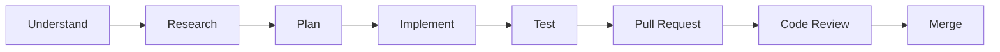

# Contributing to Milk Delivery POC

Thank you for contributing! This project is a learning environment, so the process matters as much as the result.

## The development process



| Step | What you do |
|---|---|
| Understand | Read the issue completely. Can you explain what and why in your own words? |
| Research | Read the linked docs and the technology's official documentation. |
| Plan | Write your plan as a comment on the issue before coding. |
| Implement | Work in a feature branch. Small, focused commits. |
| Test | Run tests locally. Add tests for new behaviour. |
| Pull Request | Open a PR into `develop` using the template. |
| Code Review | At least one other participant reviews. Answer every comment. |
| Merge | Squash-merge after approval and green CI. Move the card to **Done**. |

## Picking up work

1. Choose an issue in the **Ready** column of the project board.
2. Assign it to yourself and move it to **In Progress**.
3. Check the issue's prerequisites are done.
4. If anything is unclear, ask in the issue comments.

## Branches

See [`docs/08-devops/git-workflow.md`](docs/08-devops/git-workflow.md) for full detail.

```bash
git checkout develop
git pull origin develop
git checkout -b feature/12-product-list-endpoint
```

| Branch | Purpose | Created from | Merges into |
|---|---|---|---|
| `main` | Production-ready code | – | – |
| `develop` | Integration branch | `main` | `main` (release PR) |
| `feature/*` | New work | `develop` | `develop` |
| `bugfix/*` | Non-urgent fixes | `develop` | `develop` |
| `hotfix/*` | Urgent production fixes | `main` | `main` and `develop` |

## Commits

Format: `type(scope): short summary (#issue)`

Types: `feat`, `fix`, `docs`, `test`, `refactor`, `chore`, `ci`, `build`.

```
feat(backend): add GET /api/v1/products endpoint (#12)
docs(api): document order error responses (#5)
```

## Pull requests

- Target branch: `develop` (except release and hotfix PRs).
- Title follows the commit format.
- Body uses the PR template and includes `Closes #<issue>`.
- Keep PRs small: ideally under ~400 changed lines.
- Move the card to **In Review**.

## Code review

**As an author:** self-review your diff first, be ready to explain every line (including AI-generated code), respond to every comment.

**As a reviewer:** check acceptance criteria, tests, readability and scope. Be kind and specific. Ask questions that help the author learn ("Why did you choose X?"). Approve only if you understand the change.

## Using AI assistants

AI assistants are encouraged. Read [`AGENTS.md`](AGENTS.md). You are responsible for every line you submit. "Codex wrote it" is not an explanation in code review.

## Definition of Done (applies to every issue)

- [ ] All acceptance criteria met
- [ ] Tests written and passing (where applicable)
- [ ] Documentation updated
- [ ] PR reviewed and approved by another participant
- [ ] CI checks pass
- [ ] Merged into `develop`
- [ ] Board card moved to **Done**
