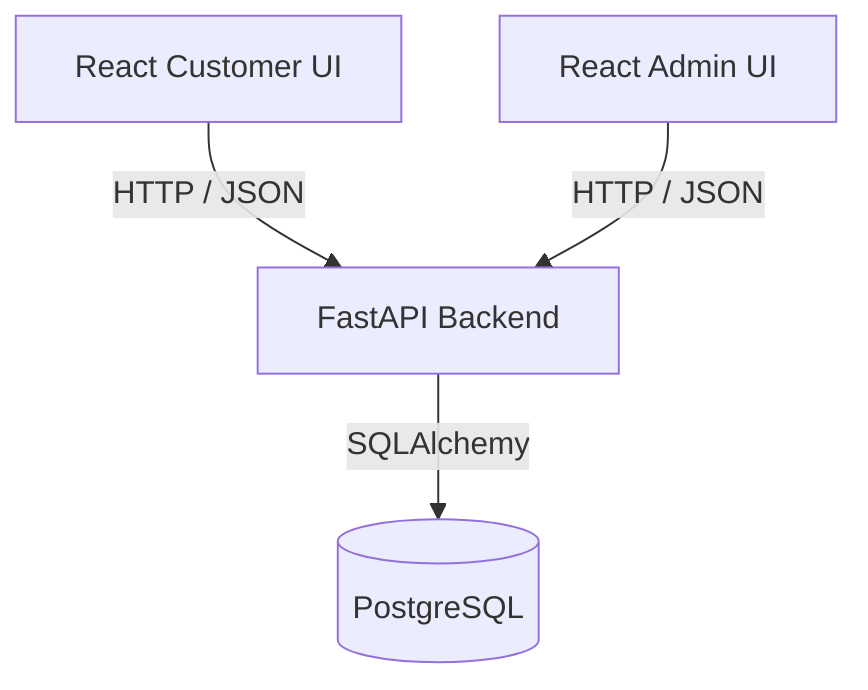

# DairyCart – Milk Delivery POC

An MVP/POC for learning the full software development lifecycle, built by a group of friends learning to build production-level AI applications.

A **learning-first** full-stack web application for a local dairy business. Customers order milk once or by subscription, the admin runs orders, stock, delivery areas and income, and delivery boys see their day's deliveries on a phone, with live tracking on a map.

> This is a proof of concept for learning the complete software development lifecycle with AI coding assistants (such as Codex). It is **not** a commercial marketplace.

## Status

**Built and running locally (Docker): M0–M5, M8, M11 and M12.** Not started: **M6** (GCP deployment) and **M7** (final demonstration). Still open in M4: backend test issues #46–#48.

### What the app does

| Who | Features | Milestone |
|---|---|---|
| Customer | Sign up and log in with mobile number and password; browse products; cart and checkout (cash on delivery, totals calculated by the backend); order history | M2, M3, M11 |
| Customer | One-time order or a 7/15/30-day subscription delivered every 1, 2 or 3 days, in a chosen delivery time slot; cancel any time | M8 |
| Customer | Saved delivery addresses with an optional map pin; track an out-for-delivery order on a map with an ETA | M8, M12 |
| Admin | Dashboard; one Orders board (filter by day, delivery boy or unassigned) with status updates; products with stock; users and their order history; subscriptions; delivery time slots | M3, M8, M11 |
| Admin | Delivery boys with areas by PIN code (an order goes to the active delivery boy covering its PIN code); give a delivery boy a login; Income tab with charts | M8, M12 |
| Admin | Live map of delivery boys on a round, updated instantly (SSE) | M12 |
| Delivery boy | Phone web page with today's deliveries in his areas; Call and **Navigate** (Google Maps directions) buttons; Start delivery → Mark delivered; share location only during a round | M12 |

Each feature's full specification is its issue in [`docs/github-issues/`](docs/github-issues/README.md), grouped by milestone.

## Technology stack

| Layer | Technology |
|---|---|
| Frontend | React, Vite, TypeScript, Tailwind CSS, shadcn/ui, Lucide React, TanStack Query, Recharts, Leaflet + OpenStreetMap |
| Backend | Python, FastAPI, Pydantic, SQLAlchemy, Alembic |
| Database | PostgreSQL |
| DevOps | Git, GitHub (Issues, Projects, Actions), Docker, Docker Compose, Codex |
| Cloud (later) | GCP Cloud Run, Cloud SQL, Artifact Registry, Secret Manager, Cloud Logging |

Adding any other framework or service requires an Architecture Decision Record (see [`docs/04-architecture/high-level-design.md`](docs/04-architecture/high-level-design.md#architecture-decisions)).

## Architecture at a glance



A **modular monolith**: one frontend app (customer, admin and delivery boy routes), one backend service, one database.

## Repository layout

```
milk-delivery-poc/
├── AGENTS.md               # Rules for AI coding assistants (read first!)
├── CONTRIBUTING.md         # How to contribute (branches, PRs, reviews)
├── docker-compose.yml      # Full local stack: db + backend + frontend (M5)
├── frontend/               # React + Vite + TypeScript app
├── backend/                # FastAPI app, tests, Alembic migrations
├── database/               # init.sql and seed.sql
├── infrastructure/         # docker/ and gcp/ deployment assets
├── docs/                   # All project documentation
│   └── github-issues/      # Markdown copies of every GitHub issue
├── scripts/                # Repository automation (GitHub bootstrap)
└── .github/                # Issue templates, PR template, workflows
```

## Milestones

| Milestone | Goal | Status |
|---|---|---|
| M0 – Project Foundation | Repo, docs, standards, board | Done |
| M1 – Backend Foundation | FastAPI skeleton, DB models, migrations, product APIs | Done |
| M2 – Frontend Foundation | UI screens with **mock JSON** data | Done |
| M3 – Order Management | Cart, orders, admin status updates, frontend ↔ backend integration | Done |
| M4 – Testing and Quality | Unit, API and UI tests; linting | Mostly done (#46–#48 open) |
| M5 – Docker and CI | Containers, Compose, GitHub Actions | Done |
| M6 – GCP Deployment | Cloud Run, Cloud SQL, secrets, logging | Not started |
| M7 – Final Demonstration | Demo, retrospective, learning review | Not started |
| M8 – Ordering, Subscriptions and Delivery Operations | Admin products, shop look, subscriptions, delivery slots, addresses, delivery boys and areas, Orders board, Income | Done |
| M11 – User Authentication and Admin Management | Accounts and roles, login to order, stock, login by mobile number | Done |
| M12 – Maps and Live Delivery Tracking | Map pins, delivery boy page, live location, admin live map, customer tracking, SSE, Navigate button | Done |

There is no M9 or M10. Milestone descriptions: [`docs/github-issues/milestones.md`](docs/github-issues/milestones.md).

## One-time GitHub setup (maintainer)

```bash
gh auth login --scopes repo,project
./scripts/setup_github.sh            # or --public
```

Creates the repo, labels, milestones M0–M7, the eight M0 issues, the `develop` branch, branch protection (where the plan allows) and the "Milk Delivery POC" Project board. It is idempotent and never deletes anything.

## Run the whole app (Docker)

One command starts everything: database, backend, frontend and a database viewer.
You only need **[Docker Desktop](https://www.docker.com/products/docker-desktop/)** (open it and wait for "Engine running"). Python, Node and PostgreSQL run inside Docker.

```bash
git clone https://github.com/samad-k-shaik/dairycart.git
cd dairycart
docker compose up --build     # first time: builds the images (a few minutes)
```

When the log calms down (or `docker compose ps` shows everything "Up"), open:

| What | Address | Login (local only) |
|---|---|---|
| 🛒 Website (shop + admin) | http://localhost:5173 | Admin: mobile `9000000001` / `admin_local_only_123` · customers register on the site |
| ⚙️ Backend API docs | http://localhost:8000/docs | – |
| 🗄️ pgAdmin (view the database) | http://localhost:5050 | `admin@example.com` / `admin123` |
| 🐘 PostgreSQL (for other tools) | `localhost:5432` | user `milk_user` / `milk_password_local_only`, database `milk_delivery` |

> These are **local development** logins. They only work on your own computer and are shown here on purpose. Never reuse them for anything real.

### See the data in pgAdmin

1. Open http://localhost:5050 and log in with `admin@example.com` / `admin123`.
2. Left panel: **Servers → DairyCart (local Docker)**. It is already set up and connects without a password.
3. Open **Databases → milk_delivery → Schemas → public → Tables**.
4. Right-click a table (e.g. `orders`) → **View/Edit Data → All Rows**.

Place an order on the website, refresh the `orders` table, and the new row appears.

### Everyday commands

| Task | Command |
|---|---|
| Start (in the background) | `docker compose up -d` |
| Start after changing code | `docker compose up -d --build` |
| Check what is running | `docker compose ps` |
| Show backend logs | `docker compose logs -f backend` |
| Stop (data is kept) | `docker compose down` |
| Stop and **delete all data** | `docker compose down -v` |

**Troubleshooting:** "port is already allocated" means something else uses 5173, 8000, 5432 or 5050 (e.g. Postgres.app, or a running `npm run dev`/`uvicorn`); stop it and try again. Code changes need `--build`. More details: [`docs/08-devops/deployment-guide.md`](docs/08-devops/deployment-guide.md#3-full-stack-with-docker-compose-m5).

## How to start

1. Read [`docs/01-project-overview.md`](docs/01-project-overview.md) and [`docs/02-project-scope.md`](docs/02-project-scope.md).
2. Read [`CONTRIBUTING.md`](CONTRIBUTING.md) and [`docs/08-devops/git-workflow.md`](docs/08-devops/git-workflow.md).
3. If you use Codex or another AI assistant, read [`AGENTS.md`](AGENTS.md).
4. Pick an issue in the **Ready** column of the GitHub Project board.
5. Follow: **Understand → Research → Plan → Implement → Test → Pull Request → Code Review → Merge**.

## Documentation index

| Area | Document |
|---|---|
| Overview | [01-project-overview.md](docs/01-project-overview.md) |
| Scope | [02-project-scope.md](docs/02-project-scope.md) |
| Requirements | [functional](docs/03-requirements/functional-requirements.md), [non-functional](docs/03-requirements/non-functional-requirements.md) |
| Architecture | [system context](docs/04-architecture/system-context.md), [HLD](docs/04-architecture/high-level-design.md), [LLD](docs/04-architecture/low-level-design.md), [ERD](docs/04-architecture/database-erd.md) |
| API | [api-contracts.md](docs/05-api/api-contracts.md) |
| UI/UX | [design-system.md](docs/06-ui-ux/design-system.md) |
| Testing | [test-strategy.md](docs/07-testing/test-strategy.md) |
| DevOps | [git-workflow](docs/08-devops/git-workflow.md), [ci-cd-strategy](docs/08-devops/ci-cd-strategy.md), [deployment-guide](docs/08-devops/deployment-guide.md) |
| Team | [roles](docs/09-team/roles-and-responsibilities.md), [learning roadmap](docs/09-team/learning-roadmap.md) |
| Issues | [docs/github-issues/](docs/github-issues/) |
