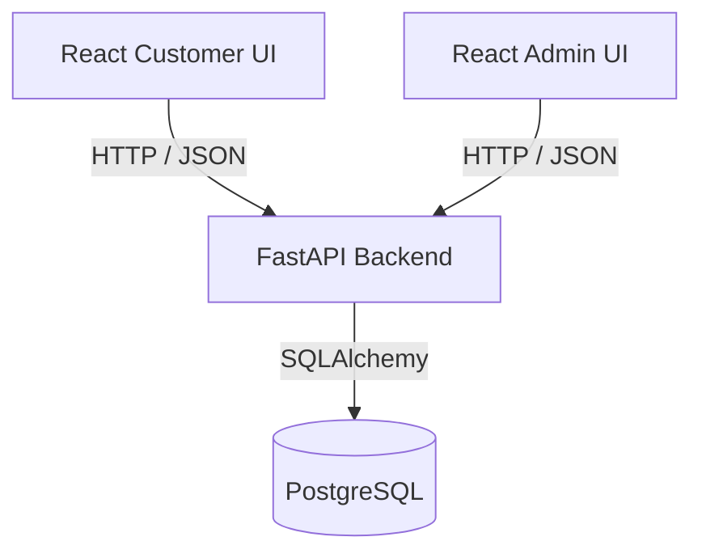

# Milk Delivery POC

A **learning-first** full-stack web application for a local dairy business. Customers browse milk products, add them to a cart, place orders and view their order history. An administrator views orders and updates their status.

> This is a proof of concept for learning the complete software development lifecycle with AI coding assistants (such as Codex). It is **not** a commercial marketplace.

## Status

**Milestone M0 – Project Foundation.** Only the repository, documentation, standards and GitHub project setup exist. No application features have been implemented yet. Source folders contain `.gitkeep` placeholders; real files (`App.tsx`, `main.tsx`, `app/main.py`, …) are created by the M1/M2 issues.

## Technology stack

| Layer | Technology |
|---|---|
| Frontend | React, Vite, TypeScript, Tailwind CSS, shadcn/ui, Lucide React, TanStack Query |
| Backend | Python, FastAPI, Pydantic, SQLAlchemy, Alembic |
| Database | PostgreSQL |
| DevOps | Git, GitHub (Issues, Projects, Actions), Docker, Docker Compose, Codex |
| Cloud (later) | GCP Cloud Run, Cloud SQL, Artifact Registry, Secret Manager, Cloud Logging |

Adding any other framework or service requires an Architecture Decision Record (see [`docs/04-architecture/high-level-design.md`](docs/04-architecture/high-level-design.md#architecture-decisions)).

## Architecture at a glance



A **modular monolith**: one frontend app (customer + admin routes), one backend service, one database.

## Repository layout

```
milk-delivery-poc/
├── AGENTS.md               # Rules for AI coding assistants (read first!)
├── CONTRIBUTING.md         # How to contribute (branches, PRs, reviews)
├── docker-compose.yml      # Local stack (filled in during M5)
├── frontend/               # React + Vite + TypeScript app
├── backend/                # FastAPI app, tests, Alembic migrations
├── database/               # init.sql and seed.sql
├── infrastructure/         # docker/ and gcp/ deployment assets
├── docs/                   # All project documentation
│   └── github-issues/      # Markdown copies of every GitHub issue
├── scripts/                # Repository automation (GitHub bootstrap)
└── .github/                # Issue templates, PR template, workflows
```

## Milestones

| Milestone | Goal |
|---|---|
| M0 – Project Foundation | Repo, docs, standards, board |
| M1 – Backend Foundation | FastAPI skeleton, DB models, migrations, product APIs |
| M2 – Frontend Foundation | UI screens with **mock JSON** data |
| M3 – Order Management | Cart, orders, admin status updates, frontend ↔ backend integration |
| M4 – Testing and Quality | Unit, API and UI tests; linting |
| M5 – Docker and CI | Containers, Compose, GitHub Actions |
| M6 – GCP Deployment | Cloud Run, Cloud SQL, secrets, logging |
| M7 – Final Demonstration | Demo, retrospective, learning review |

## One-time GitHub setup (maintainer)

```bash
gh auth login --scopes repo,project
./scripts/setup_github.sh            # or --public
```

Creates the repo, labels, milestones M0–M7, the eight M0 issues, the `develop` branch, branch protection (where the plan allows) and the "Milk Delivery POC" Project board. It is idempotent and never deletes anything.

## How to start

1. Read [`docs/01-project-overview.md`](docs/01-project-overview.md) and [`docs/02-project-scope.md`](docs/02-project-scope.md).
2. Read [`CONTRIBUTING.md`](CONTRIBUTING.md) and [`docs/08-devops/git-workflow.md`](docs/08-devops/git-workflow.md).
3. If you use Codex or another AI assistant, read [`AGENTS.md`](AGENTS.md).
4. Pick an issue in the **Ready** column of the GitHub Project board.
5. Follow: **Understand → Research → Plan → Implement → Test → Pull Request → Code Review → Merge**.

## Documentation index

| Area | Document |
|---|---|
| Overview | [01-project-overview.md](docs/01-project-overview.md) |
| Scope | [02-project-scope.md](docs/02-project-scope.md) |
| Requirements | [functional](docs/03-requirements/functional-requirements.md), [non-functional](docs/03-requirements/non-functional-requirements.md) |
| Architecture | [system context](docs/04-architecture/system-context.md), [HLD](docs/04-architecture/high-level-design.md), [LLD](docs/04-architecture/low-level-design.md), [ERD](docs/04-architecture/database-erd.md) |
| API | [api-contracts.md](docs/05-api/api-contracts.md) |
| UI/UX | [design-system.md](docs/06-ui-ux/design-system.md) |
| Testing | [test-strategy.md](docs/07-testing/test-strategy.md) |
| DevOps | [git-workflow](docs/08-devops/git-workflow.md), [ci-cd-strategy](docs/08-devops/ci-cd-strategy.md), [deployment-guide](docs/08-devops/deployment-guide.md) |
| Team | [roles](docs/09-team/roles-and-responsibilities.md), [learning roadmap](docs/09-team/learning-roadmap.md) |
| Issues | [docs/github-issues/](docs/github-issues/) |
