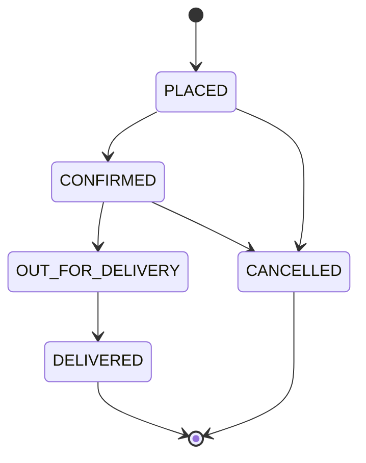

# Functional Requirements

Priority uses **MoSCoW**: Must / Should / Could. All "Must" items are required for the POC.

## Customer

| ID | Requirement | Priority | Acceptance criteria |
|---|---|---|---|
| FR-C1 | List available products | Must | Home page shows every product where `is_available = true` with name, size, price and image. Unavailable products are hidden. |
| FR-C2 | Product details | Must | Selecting a product opens a details page with name, size, price, description and an "Add to cart" action. Unknown product id shows a "Product not found" message. |
| FR-C3 | Select quantity | Must | Quantity selector allows 1–20. Values outside the range cannot be submitted. |
| FR-C4 | Add to cart | Must | Adding the same product twice increases its quantity. Cart shows line subtotals and an estimated total. Items can be removed or quantity changed. Cart survives a page refresh (browser storage). |
| FR-C5 | Place order | Must | Checkout requires name (2–100 chars) and a 10-digit Indian mobile number. Submitting sends only product ids and quantities. Backend calculates prices and total. Empty cart cannot be submitted. |
| FR-C6 | Order confirmation | Must | After success, show order id, items, backend-calculated total and status `PLACED`. Cart is cleared. |
| FR-C7 | Order history | Must | Customer enters their phone number and sees their orders, newest first, with date, total and status. Selecting one shows its details. |
| FR-C8 | Price changed notice | Should | If the backend total differs from the cart estimate, the confirmation clearly shows the backend total. |

## Admin

| ID | Requirement | Priority | Acceptance criteria |
|---|---|---|---|
| FR-A1 | Dashboard | Must | Shows total orders, today's orders, and counts per status. |
| FR-A2 | List orders | Must | Table of all orders: id, customer name, phone, date, total, status. Newest first. Filter by status. Paginated (default 20 per page). |
| FR-A3 | Order details | Must | Shows customer, items (product, size, qty, unit price, subtotal), total, status, date. |
| FR-A4 | Update status | Must | Admin can change status only along allowed transitions (below). Invalid transitions are rejected with a clear message. |
| FR-A5 | View products | Must | Table of all products including unavailable ones, with price and availability. |
| FR-A6 | Manage products *(#86)* | Must | Admin can add a product (name, size, price, availability), edit any of those fields, and delete a product. Delete asks for confirmation and is refused for a product that was already ordered (BR-7); the admin is offered "Mark unavailable" instead. Field rules match the API contract. |

## Order status lifecycle

| From | Allowed to |
|---|---|
| PLACED | CONFIRMED, CANCELLED |
| CONFIRMED | OUT_FOR_DELIVERY, CANCELLED |
| OUT_FOR_DELIVERY | DELIVERED |
| DELIVERED | – (final) |
| CANCELLED | – (final) |

## Business rules

| ID | Rule |
|---|---|
| BR-1 | `unit_price` is copied from `products.price` at order time. Later price changes do not change old orders. |
| BR-2 | `subtotal = unit_price × quantity`; `total_amount = Σ subtotal`. Calculated only by the backend. |
| BR-3 | Ordering an unavailable or non-existent product rejects the whole order. |
| BR-4 | The same product cannot appear twice in one order; the frontend merges lines, the backend rejects duplicates. |
| BR-5 | A customer is found by phone; if not found, created with the given name. |
| BR-6 | Creating an order and its items happens in a single database transaction. |
| BR-7 | A product that appears in any order cannot be deleted; it can only be marked unavailable (old orders must still show what was bought). |
| BR-8 | Product name + size is unique, ignoring upper/lower case. |

## Traceability

| Requirement | API endpoint | Screen |
|---|---|---|
| FR-C1 | `GET /api/v1/products` | Customer home |
| FR-C2 | `GET /api/v1/products/{id}` | Product details |
| FR-C3/C4 | – (client-side) | Product details, Cart |
| FR-C5/C6 | `POST /api/v1/orders` | Checkout, Confirmation |
| FR-C7 | `GET /api/v1/orders?phone=`, `GET /api/v1/orders/{id}` | Order history |
| FR-A1/A2 | `GET /api/v1/admin/orders` | Admin dashboard, Order management |
| FR-A3 | `GET /api/v1/orders/{id}` | Order management (details panel) |
| FR-A4 | `PATCH /api/v1/admin/orders/{id}/status` | Order management |
| FR-A5 | `GET /api/v1/products?include_unavailable=true` | Admin products |
| FR-A6 | `POST /api/v1/admin/products`, `PATCH`/`DELETE /api/v1/admin/products/{id}` | Admin products (form panel, delete dialog) |
