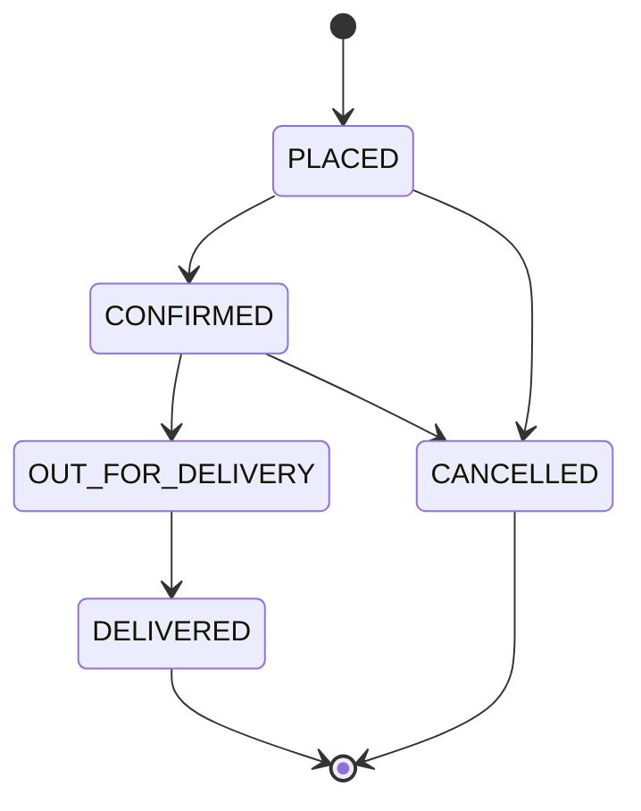

# Functional Requirements

Priority uses **MoSCoW**: Must / Should / Could. All "Must" items are required for the POC.

## Customer

| ID | Requirement | Priority | Acceptance criteria |
|---|---|---|---|
| FR-C1 | List available products | Must | Home page shows every product where `is_available = true` with name, size, price and image. Unavailable products are hidden. |
| FR-C2 | Product details | Must | Selecting a product opens a details page with name, size, price, description and an "Add to cart" action. Unknown product id shows a "Product not found" message. |
| FR-C3 | Select quantity | Must | Quantity selector allows 1–20. Values outside the range cannot be submitted. |
| FR-C4 | Add to cart | Must | Adding the same product twice increases its quantity. Cart shows line subtotals and an estimated total. Items can be removed or quantity changed. Cart survives a page refresh (browser storage). |
| FR-C5 | Place order | Must | **Login required (#90):** a logged-out visitor who opens checkout is sent to login and comes back to checkout with the same cart. The order is saved with the account. Checkout requires name (2–100 chars, pre-filled from the account), a 10-digit Indian mobile number and *(#102)* a **delivery address** (one of the saved addresses, the default chosen first, or a new one added on the page; BR-14). Submitting sends only product ids and quantities. Backend calculates prices and total. Empty cart cannot be submitted. |
| FR-C6 | Order confirmation | Must | After success, show order id, items, backend-calculated total and status `PLACED`. Cart is cleared. |
| FR-C7 | Order history | Must | "My orders" (login required, #90) lists the logged-in user's orders, newest first, with date, total and status. Selecting one shows its details. Only the owner or an admin can open an order. |
| FR-C8 | Price changed notice | Should | If the backend total differs from the cart estimate, the confirmation clearly shows the backend total. |
| FR-C9 | Order once or subscribe *(#97)* | Must | At checkout the customer chooses **Order once** (FR-C5) or **Subscribe**: the cart's items for **1 week, 15 days or 1 month**, delivered **every day, every 2 days or every 3 days** (#99), starting on a day they pick (tomorrow up to 30 days ahead), in a **delivery time slot** they choose (#100; full slots show "Full" and cannot be chosen, BR-13). The page shows the delivery days, and the summary shows the per-delivery and plan totals (estimates; the backend calculates and locks the prices). One active subscription per account (BR-10). |
| FR-C10 | My subscriptions *(#97)* | Must | "My subscriptions" lists the user's subscriptions with plan, frequency, delivery time (#100), dates, items, per-delivery and plan totals, status and deliveries so far ("1 of 4"). An active subscription has **Cancel subscription** with a confirmation; after cancelling, no further deliveries are created (BR-11). *(#100)* **Change time** moves an active subscription to another slot with places left; orders already created keep their time. Each delivery also appears in "My orders", marked "Subscription". |

## Admin

| ID | Requirement | Priority | Acceptance criteria |
|---|---|---|---|
| FR-A1 | Dashboard | Must | Shows total orders, today's orders, and counts per status. |
| FR-A2 | List orders | Must | Table of all orders: id, customer name, phone, date, total, status. Newest first. Filter by status. Paginated (default 20 per page). |
| FR-A3 | Order details | Must | Shows customer, items (product, size, qty, unit price, subtotal), total, status, date. |
| FR-A4 | Update status | Must | Admin can change status only along allowed transitions (below). Invalid transitions are rejected with a clear message. |
| FR-A5 | View products | Must | Table of all products including unavailable ones, with price and availability. |
| FR-A6 | Manage products *(#86)* | Must | Admin can add a product (name, size, price, availability), edit any of those fields, and delete a product. Delete asks for confirmation and is refused for a product that was already ordered (BR-7); the admin is offered "Mark unavailable" instead. Field rules match the API contract. |
| FR-A8 | Subscriptions *(#97, #99)* | Must | Admin sees every subscription (customer, plan, frequency, delivery time, dates, per-delivery total, orders created, status; filter by status). Delivery orders are created **automatically** (BR-12) and appear on the Orders page (with their delivery time, #100); there is no button to press. |
| FR-C11 | Saved addresses *(#102)* | Must | Account page → **Addresses** tab: list, add, edit, delete and make default. Fields: label (Home / Office…), house / flat, street / area, landmark (optional), city, 6-digit PIN code. Up to 10 per account. My subscriptions shows each plan's address with **Change address**; the order page shows where the order goes. Rules: BR-14. |
| FR-A12 | Delivery boys and areas *(#103)* | Must | A **Delivery boys** tab: add, edit (name, 10-digit phone, active) and delete delivery boys; allocate and remove areas by PIN code (with an optional locality name). Each card shows today's orders in his areas. On the **Deliveries** page each order shows its delivery boy (by the PIN code of its address) or "Not assigned", with filter chips per delivery boy whose "To load" totals are that boy's van load. Rules: BR-15. Delivery boys do not log in. |
| FR-A9 | Delivery slots *(#100)* | Must | Admin manages the delivery time slots on a **Delivery slots** page: add, edit (name, start/end time, capacity, on/off) and delete. Each slot shows booked / capacity. Two standard slots exist from the start (Morning 08:00–09:00, Evening 17:00–18:00, capacity 50). Rules: BR-13. |
| FR-A10 | Daily deliveries *(#101)* | Must | A **Deliveries** page shows one day (default today, previous/next day, date picker): the product totals to load (cancelled orders not counted), the status counts, and one card per order with the user, products × quantity, delivery time, Subscription/One-time, total and a status change (same rules as FR-A4). A day = subscription deliveries for that date + one-time orders placed that day (India time). |
| FR-A11 | User details and orders *(#101)* | Must | On the Users page the admin selects a user to open their page: details, number of orders and amount spent (cancelled orders not counted), their subscriptions, and **all their orders** (newest first); an order opens the order details panel. |
| FR-A7 | Stock *(#92)* | Must | Admin sets each product's stock (whole number 0–100000) in the add/edit form and sees it in a Stock column (0 shown as "Out of stock"). Only admins see numbers. Customers see "Out of stock" (and cannot add it to the cart) when nothing is left. Orders reduce the stock (BR-9); cancelled orders restore it. |

## Accounts (#89)

| ID | Requirement | Priority | Acceptance criteria |
|---|---|---|---|
| FR-U1 | Sign up | Must | Full name (2–100), email (valid format), username (3–30: letters, digits, `.`, `_`, `-`), password (8–72 bytes, at least one letter and one number) and confirm password (must match). Duplicate email or username (any letter case) is rejected at that field. New accounts are always `USER`. |
| FR-U2 | Log in | Must | Username **or** email + password. Wrong details show "Invalid username/email or password." (the same for unknown user and wrong password). A USER goes to the User Dashboard (`/account`), an ADMIN to the Admin Dashboard (`/admin`), or back to the page that asked for the login. |
| FR-U3 | User Dashboard | Must | `/account` shows full name, username, email, role and member-since date. Logged-out visitors are sent to the login page. |
| FR-U4 | Admin only | Must | Every `/admin` page and `/api/v1/admin/*` API needs an ADMIN login: not logged in → login page / 401; logged in as USER → "Admins only" / 403. |
| FR-U5 | Admin users list | Must | `/admin/users` lists every user (name, username, email, role, joined date). Never shows passwords or hashes. |
| FR-U6 | Log out | Must | Log out (account page, admin sidebar/top bar) removes the session and cached data; protected pages need a new login. The session also ends when the token expires (60 min). |

Admins are created only with `python -m app.scripts.create_admin` (see `backend/README.md`).

## Order status lifecycle

| From | Allowed to |
|---|---|
| PLACED | CONFIRMED, CANCELLED |
| CONFIRMED | OUT_FOR_DELIVERY, CANCELLED |
| OUT_FOR_DELIVERY | DELIVERED |
| DELIVERED | – (final) |
| CANCELLED | – (final) |

## Business rules

| ID | Rule |
|---|---|
| BR-1 | `unit_price` is copied from `products.price` at order time. Later price changes do not change old orders. |
| BR-2 | `subtotal = unit_price × quantity`; `total_amount = Σ subtotal`. Calculated only by the backend. |
| BR-3 | Ordering an unavailable or non-existent product rejects the whole order. |
| BR-4 | The same product cannot appear twice in one order; the frontend merges lines, the backend rejects duplicates. |
| BR-5 | A customer is found by phone; if not found, created with the given name. |
| BR-6 | Creating an order and its items happens in a single database transaction. |
| BR-7 | A product that appears in any order cannot be deleted; it can only be marked unavailable (old orders must still show what was bought). |
| BR-8 | Product name + size is unique, ignoring upper/lower case. |
| BR-10 | Subscriptions *(#97)*: plans are 7, 15 or 30 days, including the start day (tomorrow at the earliest, at most 30 days ahead, India time). *(#99)* Deliveries are every day, every 2nd or every 3rd day from the start; the plan keeps its length (1 week every 2 days = 4 deliveries) and the plan total is per-delivery total × deliveries. Prices are locked when subscribing. A user may have only one ACTIVE subscription (enforced by the database). After the last day it becomes COMPLETED. |
| BR-11 | Cancelling a subscription (owner or admin) stops future orders only; an order already created for today stays. Only an ACTIVE subscription can be cancelled. |
| BR-12 | The backend creates delivery orders **automatically** (at startup, then every 15 minutes, #99): for today, one normal order per ACTIVE subscription that delivers that day, with the locked prices, reducing stock like any order (BR-9). It never creates two orders for the same subscription and day. If a product is unavailable or out of stock, that subscription is skipped for the day and continues. *(#100)* Each delivery order keeps a copy of the subscription's delivery time. |
| BR-15 | *(#103)* Each PIN code is allocated to at most one delivery boy (a second allocation is refused, naming the current owner). An order belongs to the ACTIVE delivery boy covering its address's PIN code, looked up when the deliveries are shown (moving an area moves its orders); orders without a match, or whose delivery boy is inactive, are "Not assigned". Deleting a delivery boy frees his areas. Orders and subscriptions keep the address's PIN code (`delivery_pincode`). |
| BR-14 | *(#102)* Every new order and subscription needs a delivery address that belongs to the user (none chosen → the default; no address at all → refused). The first saved address is the default; there is always exactly one default while the user has addresses (deleting the default makes the oldest remaining one the default). Orders and subscriptions keep a **text copy** of the address, so editing or deleting a saved address never changes past orders; subscription delivery orders copy the subscription's address. |
| BR-13 | *(#100)* Every new subscription books one active delivery slot. Capacity = maximum number of ACTIVE subscriptions in the slot; cancelled and completed plans free their place, and bookings are checked under a row lock so a slot is never overbooked. Lowering the capacity never removes a booking. A switched-off slot is hidden from new subscribers but kept by existing ones. A booked slot cannot be deleted, and the last active slot cannot be switched off or deleted. |
| BR-9 | Placing an order reduces each product's stock by the ordered quantity, in the same transaction, with the product rows locked. A quantity above the stock rejects the whole order (409 `INSUFFICIENT_STOCK`). Cancelling an order adds the quantities back. Stock never goes below 0. |

## Traceability

| Requirement | API endpoint | Screen |
|---|---|---|
| FR-C1 | `GET /api/v1/products` | Customer home |
| FR-C2 | `GET /api/v1/products/{id}` | Product details |
| FR-C3/C4 | – (client-side) | Product details, Cart |
| FR-C5/C6 | `POST /api/v1/orders` | Checkout, Confirmation |
| FR-C7 | `GET /api/v1/orders/mine`, `GET /api/v1/orders/{id}` | My orders |
| FR-C9 | `POST /api/v1/subscriptions` | Checkout (Subscribe) |
| FR-C10 | `GET /api/v1/subscriptions/mine`, `POST /api/v1/subscriptions/{id}/cancel` | My subscriptions |
| FR-C11 | `GET/POST /api/v1/addresses`, `PATCH/DELETE /api/v1/addresses/{id}`, `POST /api/v1/addresses/{id}/default`, `PATCH /api/v1/subscriptions/{id}/address` | Account → Addresses; checkout; My subscriptions |
| FR-A8 | `GET /api/v1/admin/subscriptions` (orders: automatic background job) | Admin subscriptions |
| FR-A10 | `GET /api/v1/admin/deliveries?date=`, `PATCH /api/v1/admin/orders/{id}/status` | Admin deliveries |
| FR-A11 | `GET /api/v1/admin/users/{id}`, `GET /api/v1/admin/users/{id}/orders`, `GET /api/v1/admin/subscriptions?user_id=` | Admin user details |
| FR-A12 | `GET/POST /api/v1/admin/delivery-boys`, `PATCH/DELETE /api/v1/admin/delivery-boys/{id}`, `POST /api/v1/admin/delivery-boys/{id}/areas`, `DELETE /api/v1/admin/delivery-boys/{id}/areas/{pincode}`, `GET /api/v1/admin/deliveries?boy=` | Admin delivery boys; deliveries |
| FR-A9 | `GET/POST /api/v1/admin/delivery-slots`, `PATCH/DELETE /api/v1/admin/delivery-slots/{id}`; customers: `GET /api/v1/delivery-slots`, `PATCH /api/v1/subscriptions/{id}/delivery-slot` | Admin delivery slots; checkout; My subscriptions |
| FR-A1/A2 | `GET /api/v1/admin/orders` | Admin dashboard, Order management |
| FR-A3 | `GET /api/v1/orders/{id}` | Order management (details panel) |
| FR-A4 | `PATCH /api/v1/admin/orders/{id}/status` | Order management |
| FR-A5 | `GET /api/v1/products?include_unavailable=true` | Admin products |
| FR-A6 | `POST /api/v1/admin/products`, `PATCH`/`DELETE /api/v1/admin/products/{id}` | Admin products (form panel, delete dialog) |
| FR-U1 | `POST /api/v1/auth/register` | Sign up |
| FR-U2 | `POST /api/v1/auth/login` | Log in |
| FR-U3 | `GET /api/v1/auth/me` | User Dashboard |
| FR-U4/U5 | `GET /api/v1/admin/users` (every admin API needs an ADMIN token) | Admin users |
