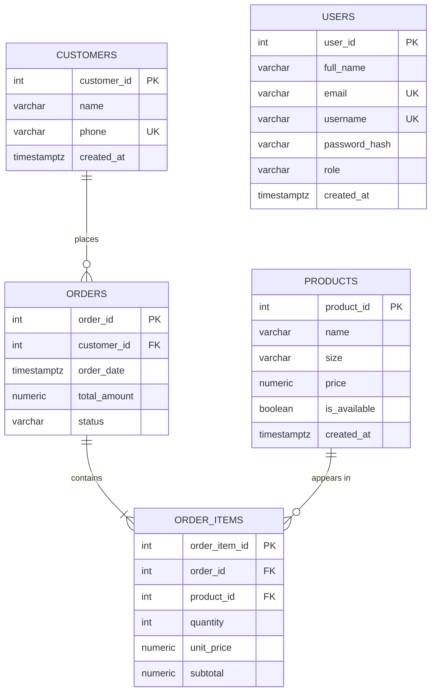

# Database ERD

## Diagram

`USERS` (#89) has no relationship to the other tables: ordering does not need an account (guest checkout, customer found by phone).

## Tables

### CUSTOMERS

| Column | Type | Constraints | Notes |
|---|---|---|---|
| customer_id | SERIAL | PK | |
| name | VARCHAR(100) | NOT NULL | |
| phone | VARCHAR(15) | NOT NULL, UNIQUE | Identifies the customer (no login in POC) |
| created_at | TIMESTAMPTZ | NOT NULL, default now() | Audit column (added beyond the minimum list) |

### PRODUCTS

| Column | Type | Constraints | Notes |
|---|---|---|---|
| product_id | SERIAL | PK | |
| name | VARCHAR(100) | NOT NULL | e.g. "Cow Milk" |
| size | VARCHAR(20) | NOT NULL | e.g. "500 ml" |
| price | NUMERIC(10,2) | NOT NULL, CHECK > 0 | Current price in INR |
| is_available | BOOLEAN | NOT NULL, default TRUE | Hidden from customers when false |
| created_at | TIMESTAMPTZ | NOT NULL, default now() | Audit column |
| | | UNIQUE (name, size) | Prevents duplicate catalogue entries |

### ORDERS

| Column | Type | Constraints | Notes |
|---|---|---|---|
| order_id | SERIAL | PK | |
| customer_id | INTEGER | FK → customers, NOT NULL, ON DELETE RESTRICT | |
| order_date | TIMESTAMPTZ | NOT NULL, default now() | Stored in UTC, displayed in IST |
| total_amount | NUMERIC(10,2) | NOT NULL, CHECK ≥ 0 | Sum of item subtotals, calculated by backend |
| status | VARCHAR(20) | NOT NULL, default 'PLACED', CHECK in allowed values | See lifecycle in functional requirements |

### ORDER_ITEMS

| Column | Type | Constraints | Notes |
|---|---|---|---|
| order_item_id | SERIAL | PK | |
| order_id | INTEGER | FK → orders, NOT NULL, ON DELETE CASCADE | |
| product_id | INTEGER | FK → products, NOT NULL, ON DELETE RESTRICT | |
| quantity | INTEGER | NOT NULL, CHECK 1–20 | |
| unit_price | NUMERIC(10,2) | NOT NULL, CHECK > 0 | Price **snapshot** at order time |
| subtotal | NUMERIC(10,2) | NOT NULL, CHECK ≥ 0 | unit_price × quantity |
| | | UNIQUE (order_id, product_id) | One line per product per order |

## Relationships

| Relationship | Cardinality | Meaning |
|---|---|---|
| CUSTOMERS → ORDERS | 1 to 0..many | A customer can have many orders; each order belongs to exactly one customer |
| ORDERS → ORDER_ITEMS | 1 to 1..many | An order has at least one item; an item belongs to one order |
| PRODUCTS → ORDER_ITEMS | 1 to 0..many | A product can appear in many order lines |

`ORDERS` ↔ `PRODUCTS` is a **many-to-many** relationship resolved by the junction table `ORDER_ITEMS`.

### USERS (#89)

| Column | Type | Constraints | Notes |
|---|---|---|---|
| user_id | SERIAL | PK | |
| full_name | VARCHAR(100) | NOT NULL | 2–100 characters |
| email | VARCHAR(254) | NOT NULL, UNIQUE | Stored in lower case |
| username | VARCHAR(30) | NOT NULL, UNIQUE | Stored in lower case; letters, digits, `.`, `_`, `-` |
| password_hash | VARCHAR(100) | NOT NULL | bcrypt hash (60 chars). **Never** the password |
| role | VARCHAR(10) | NOT NULL, DEFAULT `'USER'`, CHECK in (`USER`, `ADMIN`) | `ADMIN` only via `python -m app.scripts.create_admin` |
| created_at | TIMESTAMPTZ | NOT NULL, DEFAULT now() | |

## Normalization notes

- **1NF:** every column holds a single value; order lines are rows in `order_items`, not a list inside `orders`.
- **2NF:** in `order_items`, every non-key column depends on the whole key (`order_item_id`; also unique on `order_id + product_id`).
- **3NF:** customer name/phone live only in `customers`; product name/size only in `products`.

**Deliberate denormalization (and why it's correct):**
- `order_items.unit_price` copies `products.price` so historical orders keep the price paid even if the product price changes later.
- `order_items.subtotal` and `orders.total_amount` are derived values stored for fast reads and auditability. They are written once by the backend service and never edited by clients.

## Why `ON DELETE RESTRICT`?

Products and customers that appear in orders cannot be deleted, protecting order history. To remove a product from sale, set `is_available = false`.

## Indexes

| Index | Supports |
|---|---|
| `orders(customer_id)` | Order history by customer |
| `orders(status)` | Admin filter by status |
| `order_items(order_id)` | Loading items for an order |
| `customers(phone)` (via UNIQUE) | Find customer by phone |

## Constraint names

Every constraint has an explicit, readable name (set by the naming convention in `backend/app/database/base.py`, M1-05) so migrations and error messages are easy to read. `database/init.sql` uses the same names.

| Table | Constraint | Rule |
|---|---|---|
| customers | `uq_customers_phone` | phone is unique |
| products | `ck_products_price_positive` | price > 0 |
| products | `uq_products_name_size` | (name, size) is unique |
| orders | `orders_customer_id_fkey` | → customers, ON DELETE RESTRICT |
| orders | `ck_orders_total_amount_non_negative` | total_amount ≥ 0 |
| orders | `ck_orders_status_allowed` | status in the five allowed values |
| order_items | `order_items_order_id_fkey` | → orders, ON DELETE CASCADE |
| order_items | `order_items_product_id_fkey` | → products, ON DELETE RESTRICT |
| order_items | `ck_order_items_quantity_range` | quantity between 1 and 20 |
| order_items | `ck_order_items_unit_price_positive` | unit_price > 0 |
| order_items | `ck_order_items_subtotal_non_negative` | subtotal ≥ 0 |
| order_items | `uq_order_items_order_product` | (order_id, product_id) is unique |
| users | `uq_users_email` | email is unique |
| users | `uq_users_username` | username is unique |
| users | `ck_users_role_allowed` | role is `USER` or `ADMIN` |

Primary keys use PostgreSQL's default names (`customers_pkey`, …).

Reference DDL: [`../../database/init.sql`](../../database/init.sql). Seed data: [`../../database/seed.sql`](../../database/seed.sql).
