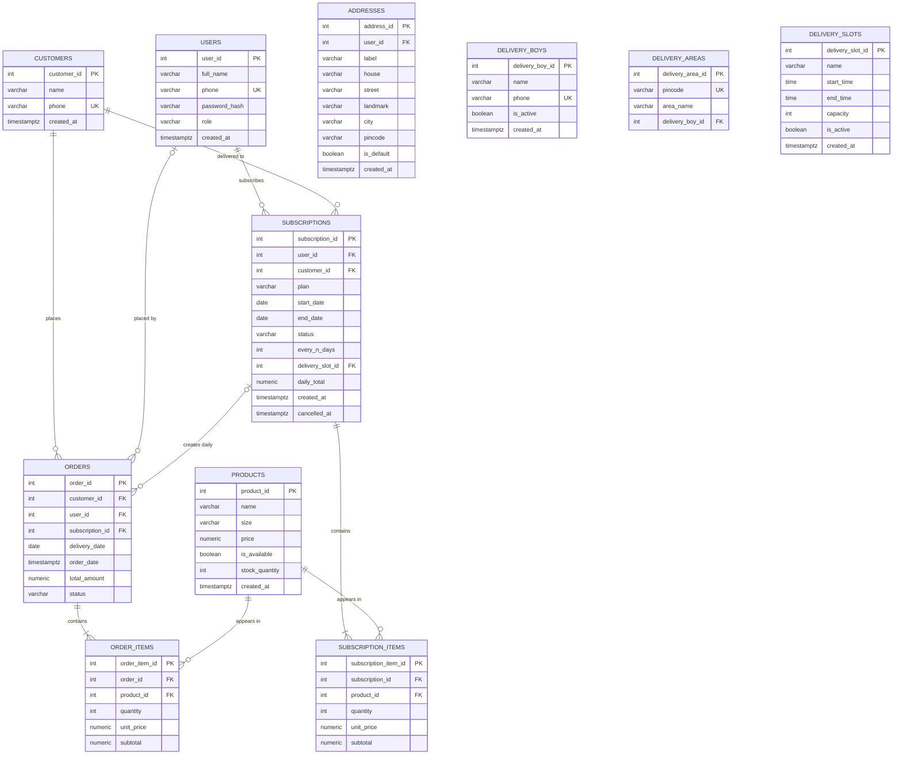

# Database ERD

## Diagram

`DELIVERY_SLOTS` (#100) → `SUBSCRIPTIONS`: each subscription books one slot (`subscriptions.delivery_slot_id`, NULL only for subscriptions from before #100). Orders keep a **text copy** of the slot (`orders.delivery_slot`), not a foreign key.

`DELIVERY_BOYS` → `DELIVERY_AREAS` (#103): each PIN code belongs to at most one delivery boy. Orders are matched to a delivery boy through `orders.delivery_pincode` when the deliveries are shown (no foreign key from orders).

`USERS` → `ADDRESSES` (#102): saved delivery addresses, one default per user. Orders and subscriptions keep a **text copy** (`delivery_address`), not a foreign key, so addresses can be edited or deleted freely.

`USERS` (#89) → `ORDERS` (#90): every new order belongs to the account that placed it (`orders.user_id`). Orders placed before #90 (guest checkout) have `user_id = NULL`. `CUSTOMERS` stays the delivery contact (name + phone from checkout).

## Tables

### CUSTOMERS

| Column | Type | Constraints | Notes |
|---|---|---|---|
| customer_id | SERIAL | PK | |
| name | VARCHAR(100) | NOT NULL | |
| phone | VARCHAR(15) | NOT NULL, UNIQUE | Identifies the customer (no login in POC) |
| created_at | TIMESTAMPTZ | NOT NULL, default now() | Audit column (added beyond the minimum list) |

### PRODUCTS

| Column | Type | Constraints | Notes |
|---|---|---|---|
| product_id | SERIAL | PK | |
| name | VARCHAR(100) | NOT NULL | e.g. "Cow Milk" |
| size | VARCHAR(20) | NOT NULL | e.g. "500 ml" |
| price | NUMERIC(10,2) | NOT NULL, CHECK > 0 | Current price in INR |
| is_available | BOOLEAN | NOT NULL, default TRUE | Hidden from customers when false |
| stock_quantity | INTEGER | NOT NULL, DEFAULT 0, CHECK ≥ 0 | Bottles left (#92). Admin-only number; orders reduce it, cancelling restores it |
| created_at | TIMESTAMPTZ | NOT NULL, default now() | Audit column |
| | | UNIQUE (name, size) | Prevents duplicate catalogue entries |

### ORDERS

| Column | Type | Constraints | Notes |
|---|---|---|---|
| order_id | SERIAL | PK | |
| customer_id | INTEGER | FK → customers, NOT NULL, ON DELETE RESTRICT | |
| order_date | TIMESTAMPTZ | NOT NULL, default now() | Stored in UTC, displayed in IST |
| total_amount | NUMERIC(10,2) | NOT NULL, CHECK ≥ 0 | Sum of item subtotals, calculated by backend |
| status | VARCHAR(20) | NOT NULL, default 'PLACED', CHECK in allowed values | See lifecycle in functional requirements |
| subscription_id | INTEGER | FK → subscriptions, NULL, ON DELETE RESTRICT | #97: the subscription that created this order; NULL for one-time orders |
| delivery_date | DATE | NULL | #97: the day (India time) a subscription order is for |
| | | UNIQUE (subscription_id, delivery_date) | #97: one order per subscription per day (NULLs never clash) |
| delivery_address | VARCHAR(500) | NULL | #102: copy of the chosen address (`full_text`) when the order was made; NULL for orders from before #102 |
| delivery_pincode | VARCHAR(6) | NULL | #103: that address's PIN code, to match the delivery boy |
| delivery_latitude | NUMERIC(9,6) | NULL, CHECK −90…90 | #108: copy of the address's map pin |
| delivery_longitude | NUMERIC(9,6) | NULL, CHECK −180…180 | #108; both NULL or both set |
| delivery_slot | VARCHAR(100) | NULL | #100: copy of the subscription's slot label when the order was created, e.g. "Morning, 8:00 AM – 9:00 AM"; NULL for one-time orders |

### ORDER_ITEMS

| Column | Type | Constraints | Notes |
|---|---|---|---|
| order_item_id | SERIAL | PK | |
| order_id | INTEGER | FK → orders, NOT NULL, ON DELETE CASCADE | |
| product_id | INTEGER | FK → products, NOT NULL, ON DELETE RESTRICT | |
| quantity | INTEGER | NOT NULL, CHECK 1–20 | |
| unit_price | NUMERIC(10,2) | NOT NULL, CHECK > 0 | Price **snapshot** at order time |
| subtotal | NUMERIC(10,2) | NOT NULL, CHECK ≥ 0 | unit_price × quantity |
| | | UNIQUE (order_id, product_id) | One line per product per order |

## Relationships

| Relationship | Cardinality | Meaning |
|---|---|---|
| CUSTOMERS → ORDERS | 1 to 0..many | A customer can have many orders; each order belongs to exactly one customer |
| ORDERS → ORDER_ITEMS | 1 to 1..many | An order has at least one item; an item belongs to one order |
| PRODUCTS → ORDER_ITEMS | 1 to 0..many | A product can appear in many order lines |

`ORDERS` ↔ `PRODUCTS` is a **many-to-many** relationship resolved by the junction table `ORDER_ITEMS`.

### USERS (#89; mobile number login since #121)

| Column | Type | Constraints | Notes |
|---|---|---|---|
| user_id | SERIAL | PK | |
| full_name | VARCHAR(100) | NOT NULL | 2–100 characters |
| phone | VARCHAR(10) | NOT NULL, UNIQUE, CHECK `^[6-9][0-9]{9}$` | The login (#121): 10-digit mobile number, saved without `+91` or spaces. Separate from `customers.phone`, which is the delivery contact typed at checkout. (`email` and `username` were removed in #121.) |
| password_hash | VARCHAR(100) | NOT NULL | bcrypt hash (60 chars). **Never** the password |
| role | VARCHAR(20) | NOT NULL, DEFAULT `'USER'`, CHECK in (`USER`, `ADMIN`, `DELIVERY_BOY`) | `ADMIN` only via `python -m app.scripts.create_admin`; `DELIVERY_BOY` only via the admin's "Give login" (#109) |
| created_at | TIMESTAMPTZ | NOT NULL, DEFAULT now() | |

### SUBSCRIPTIONS (#97)

| Column | Type | Constraints | Notes |
|---|---|---|---|
| subscription_id | SERIAL | PK | |
| user_id | INTEGER | FK → users, NOT NULL, ON DELETE RESTRICT | The account that subscribed |
| customer_id | INTEGER | FK → customers, NOT NULL, ON DELETE RESTRICT | Delivery contact (name + phone) |
| plan | VARCHAR(20) | NOT NULL, CHECK in (`WEEK`, `HALF_MONTH`, `MONTH`) | 7, 15 or 30 days |
| start_date | DATE | NOT NULL | First delivery day |
| end_date | DATE | NOT NULL, CHECK ≥ start_date | Last delivery day, included |
| status | VARCHAR(20) | NOT NULL, DEFAULT `'ACTIVE'`, CHECK in (`ACTIVE`, `CANCELLED`, `COMPLETED`) | |
| every_n_days | INTEGER | NOT NULL, DEFAULT 1, CHECK in (1, 2, 3) | #99: deliver every day / every 2nd / every 3rd day from start_date |
| delivery_slot_id | INTEGER | FK → delivery_slots, NULL, ON DELETE RESTRICT | #100: booked delivery time; NULL only for subscriptions from before #100 |
| delivery_address | VARCHAR(500) | NULL | #102: copy of the chosen address; each delivery order copies it. NULL before #102 |
| delivery_pincode | VARCHAR(6) | NULL | #103: its PIN code (copied onto each delivery order) |
| delivery_latitude | NUMERIC(9,6) | NULL, CHECK −90…90 | #108: copy of the address's map pin (copied onto each delivery order) |
| delivery_longitude | NUMERIC(9,6) | NULL, CHECK −180…180 | #108; both NULL or both set |
| daily_total | NUMERIC(10,2) | NOT NULL, CHECK ≥ 0 | One delivery's total: sum of the item subtotals (locked prices) |
| created_at | TIMESTAMPTZ | NOT NULL, DEFAULT now() | |
| cancelled_at | TIMESTAMPTZ | NULL | Set when cancelled |
| | | UNIQUE (user_id) WHERE status = 'ACTIVE' | One active subscription per user (partial unique index) |

### SUBSCRIPTION_ITEMS (#97)

| Column | Type | Constraints | Notes |
|---|---|---|---|
| subscription_item_id | SERIAL | PK | |
| subscription_id | INTEGER | FK → subscriptions, NOT NULL, ON DELETE CASCADE | |
| product_id | INTEGER | FK → products, NOT NULL, ON DELETE RESTRICT | A product in a subscription cannot be deleted |
| quantity | INTEGER | NOT NULL, CHECK 1–20 | Per day |
| unit_price | NUMERIC(10,2) | NOT NULL, CHECK > 0 | Price **locked** when subscribing; every daily order uses it |
| subtotal | NUMERIC(10,2) | NOT NULL, CHECK ≥ 0 | unit_price × quantity |
| | | UNIQUE (subscription_id, product_id) | One line per product |

### DELIVERY_SLOTS (#100)

| Column | Type | Constraints | Notes |
|---|---|---|---|
| delivery_slot_id | SERIAL | PK | |
| name | VARCHAR(50) | NOT NULL | e.g. "Morning" |
| start_time | TIME | NOT NULL | India time, no date |
| end_time | TIME | NOT NULL, CHECK > start_time | |
| capacity | INTEGER | NOT NULL, CHECK 1–1000 | Max number of ACTIVE subscriptions in the slot |
| is_active | BOOLEAN | NOT NULL, DEFAULT TRUE | Switched off: hidden from new subscribers; existing bookings keep it |
| created_at | TIMESTAMPTZ | NOT NULL, DEFAULT now() | |
| | | UNIQUE (start_time, end_time) | No two slots with the same times |

The migration inserts two standard slots: Morning 08:00–09:00 and Evening 17:00–18:00 (capacity 50).

### ADDRESSES (#102)

| Column | Type | Constraints | Notes |
|---|---|---|---|
| address_id | SERIAL | PK | |
| user_id | INTEGER | FK → users, NOT NULL, ON DELETE CASCADE | Orders keep their own copy, so the addresses can go with the account |
| label | VARCHAR(30) | NOT NULL | "Home", "Office"… |
| house | VARCHAR(100) | NOT NULL | House / flat number, building |
| street | VARCHAR(150) | NOT NULL | Street / area |
| landmark | VARCHAR(100) | NULL | Optional |
| city | VARCHAR(50) | NOT NULL | |
| pincode | VARCHAR(6) | NOT NULL, CHECK `^[1-9][0-9]{5}$` | Indian PIN code |
| latitude | NUMERIC(9,6) | NULL, CHECK −90…90 | #108: optional map pin (6 decimals ≈ 11 cm; read as a float, sent as a JSON number) |
| longitude | NUMERIC(9,6) | NULL, CHECK −180…180 | #108 |
| | | CHECK both NULL or both set | #108: half a pin is refused |
| is_default | BOOLEAN | NOT NULL, DEFAULT FALSE | |
| created_at | TIMESTAMPTZ | NOT NULL, DEFAULT now() | |
| | | UNIQUE (user_id) WHERE is_default | One default per user (partial unique index) |

### DELIVERY_BOYS (#103)

| Column | Type | Constraints | Notes |
|---|---|---|---|
| delivery_boy_id | SERIAL | PK | |
| name | VARCHAR(100) | NOT NULL | |
| phone | VARCHAR(10) | NOT NULL, UNIQUE, CHECK `^[6-9][0-9]{9}$` | 10-digit mobile number |
| is_active | BOOLEAN | NOT NULL, DEFAULT TRUE | Inactive: areas kept, orders not assigned |
| created_at | TIMESTAMPTZ | NOT NULL, DEFAULT now() | |
| user_id | INTEGER | FK → users, NULL, UNIQUE, ON DELETE SET NULL | #109: his login (role `DELIVERY_BOY`, same phone and name); NULL = no login |
| round_started_at | TIMESTAMPTZ | NULL | #110: when he pressed "Start round"; NULL = not on a round (his location is refused) |

Admin records. Since #109 the admin can give a delivery boy a login (`user_id`); deleting the delivery boy also deletes that account.

### DELIVERY_AREAS (#103)

| Column | Type | Constraints | Notes |
|---|---|---|---|
| delivery_area_id | SERIAL | PK | |
| pincode | VARCHAR(6) | NOT NULL, UNIQUE, CHECK `^[1-9][0-9]{5}$` | One delivery boy per PIN code |
| area_name | VARCHAR(50) | NULL | Optional locality, e.g. "Ameerpet" |
| delivery_boy_id | INTEGER | FK → delivery_boys, NOT NULL, ON DELETE CASCADE | Deleting a delivery boy frees his areas |

The migration fills `orders.delivery_pincode` and `subscriptions.delivery_pincode` of existing rows from the end of `delivery_address`.

## Planned changes (M12, #106 – not migrated yet)

Approved by #106 (ADR-018). Each change arrives in its own Alembic migration in the issue named. Until then, the tables above are the real schema.

**Map pins (#108): done.** Now part of ADDRESSES, ORDERS and SUBSCRIPTIONS above (migration `aa76e3a3f9c4`).

**Delivery boy login (#109): done.** `delivery_boys.user_id` and the `DELIVERY_BOY` role are part of the tables above (migration `55754c848525`).

### DELIVERY_LOCATIONS (#110)

The latest position only, one row per delivery boy, overwritten on every update (upsert, migration `b01d7b7a246d`). The row exists only during a round.

| Column | Type | Constraints | Notes |
|---|---|---|---|
| delivery_boy_id | INTEGER | PK, FK → delivery_boys, ON DELETE CASCADE | |
| latitude | NUMERIC(9,6) | NOT NULL, CHECK −90…90 | |
| longitude | NUMERIC(9,6) | NOT NULL, CHECK −180…180 | |
| accuracy_m | INTEGER | NULL, CHECK ≥ 0 | GPS accuracy reported by the phone, in metres |
| recorded_at | TIMESTAMPTZ | NOT NULL | Time on the phone when the position was read |
| updated_at | TIMESTAMPTZ | NOT NULL, DEFAULT now() | Time the server saved it; older than 2 minutes = stale |

A reading only replaces the saved one if its `recorded_at` is **newer** (late requests never move the pin back); a phone clock ahead of the server is clamped to the server's time. Stopping the round (or logging out) deletes the row; there is no location history (NFR-17).

## Normalization notes

- **1NF:** every column holds a single value; order lines are rows in `order_items`, not a list inside `orders`.
- **2NF:** in `order_items`, every non-key column depends on the whole key (`order_item_id`; also unique on `order_id + product_id`).
- **3NF:** customer name/phone live only in `customers`; product name/size only in `products`.

**Deliberate denormalization (and why it's correct):**
- `order_items.unit_price` copies `products.price` so historical orders keep the price paid even if the product price changes later.
- `orders.delivery_address` and `subscriptions.delivery_address` (#102) copy the address text for the same reason, and `delivery_latitude` / `delivery_longitude` (#108) copy its map pin.
- `orders.delivery_slot` (#100) copies the slot's label for the same reason: an order keeps the time it was booked for even if the admin edits the slot later.
- `order_items.subtotal` and `orders.total_amount` are derived values stored for fast reads and auditability. They are written once by the backend service and never edited by clients.

## Why `ON DELETE RESTRICT`?

Products and customers that appear in orders cannot be deleted, protecting order history. To remove a product from sale, set `is_available = false`.

## Indexes

| Index | Supports |
|---|---|
| `orders(customer_id)` | Order history by customer |
| `orders(status)` | Admin filter by status |
| `order_items(order_id)` | Loading items for an order |
| `customers(phone)` (via UNIQUE) | Find customer by phone |
| `subscriptions(user_id)`, `subscriptions(status)` | My subscriptions; daily order run (#97) |
| `uq_subscriptions_one_active_per_user` (partial, `WHERE status = 'ACTIVE'`) | One active subscription per user (#97) |
| `uq_orders_subscription_day` (UNIQUE) | No duplicate daily order; finding today's orders (#97) |
| `subscriptions(delivery_slot_id)` | Counting a slot's bookings (#100) |
| `addresses(user_id)`, `uq_addresses_one_default_per_user` (partial) | My addresses; one default per user (#102) |

## Constraint names

Every constraint has an explicit, readable name (set by the naming convention in `backend/app/database/base.py`, M1-05) so migrations and error messages are easy to read. `database/init.sql` uses the same names.

| Table | Constraint | Rule |
|---|---|---|
| customers | `uq_customers_phone` | phone is unique |
| products | `ck_products_price_positive` | price > 0 |
| products | `uq_products_name_size` | (name, size) is unique |
| products | `ck_products_stock_quantity_non_negative` | stock_quantity ≥ 0 (#92) |
| orders | `orders_customer_id_fkey` | → customers, ON DELETE RESTRICT |
| orders | `orders_user_id_fkey` | → users, ON DELETE RESTRICT (#90) |
| orders | `ck_orders_total_amount_non_negative` | total_amount ≥ 0 |
| orders | `ck_orders_status_allowed` | status in the five allowed values |
| order_items | `order_items_order_id_fkey` | → orders, ON DELETE CASCADE |
| order_items | `order_items_product_id_fkey` | → products, ON DELETE RESTRICT |
| order_items | `ck_order_items_quantity_range` | quantity between 1 and 20 |
| order_items | `ck_order_items_unit_price_positive` | unit_price > 0 |
| order_items | `ck_order_items_subtotal_non_negative` | subtotal ≥ 0 |
| order_items | `uq_order_items_order_product` | (order_id, product_id) is unique |
| orders | `orders_subscription_id_fkey` | → subscriptions, ON DELETE RESTRICT (#97) |
| orders | `uq_orders_subscription_day` | (subscription_id, delivery_date) is unique (#97) |
| subscriptions | `ck_subscriptions_plan_allowed`, `ck_subscriptions_status_allowed` | allowed values (#97) |
| subscriptions | `ck_subscriptions_end_after_start`, `ck_subscriptions_daily_total_non_negative` | end_date ≥ start_date, daily_total ≥ 0 (#97) |
| subscriptions | `ck_subscriptions_every_n_days_allowed` | every_n_days in (1, 2, 3) (#99) |
| subscriptions | `subscriptions_delivery_slot_id_fkey` | → delivery_slots, ON DELETE RESTRICT (#100) |
| delivery_slots | `ck_delivery_slots_end_after_start`, `ck_delivery_slots_capacity_range` | end_time > start_time, capacity 1–1000 (#100) |
| delivery_slots | `uq_delivery_slots_times` | (start_time, end_time) is unique (#100) |
| addresses | `addresses_user_id_fkey` | → users, ON DELETE CASCADE (#102) |
| addresses | `ck_addresses_pincode_format` | 6-digit PIN code not starting with 0 (#102) |
| addresses, orders, subscriptions | `ck_<table>_<latitude column>_range`, `ck_<table>_<longitude column>_range`, `ck_<table>_map_pin_complete` | map pin in range, and both set or both NULL (#108) |
| delivery_boys | `uq_delivery_boys_phone`, `ck_delivery_boys_phone_format` | phone unique and a 10-digit mobile number (#103) |
| delivery_areas | `uq_delivery_areas_pincode`, `ck_delivery_areas_pincode_format` | one delivery boy per PIN code; PIN format (#103) |
| delivery_locations | `ck_delivery_locations_latitude_range`, `…_longitude_range`, `…_accuracy_non_negative`; `delivery_locations_delivery_boy_id_fkey` | position in range, accuracy ≥ 0; → delivery_boys, ON DELETE CASCADE (#110) |
| delivery_areas | `delivery_areas_delivery_boy_id_fkey` | → delivery_boys, ON DELETE CASCADE (#103) |
| subscription_items | `ck_subscription_items_quantity_range`, `…_unit_price_positive`, `…_subtotal_non_negative` | as for order_items (#97) |
| subscription_items | `uq_subscription_items_product` | (subscription_id, product_id) is unique (#97) |
| users | `uq_users_phone`, `ck_users_phone_format` | phone unique and a 10-digit mobile number (#121) |
| users | `ck_users_role_allowed` | role is `USER`, `ADMIN` or `DELIVERY_BOY` (#109) |
| delivery_boys | `uq_delivery_boys_user_id`, `delivery_boys_user_id_fkey` | one login per delivery boy; → users, ON DELETE SET NULL (#109) |

Primary keys use PostgreSQL's default names (`customers_pkey`, …).

Reference DDL: [`../../database/init.sql`](../../database/init.sql). Seed data: [`../../database/seed.sql`](../../database/seed.sql).
