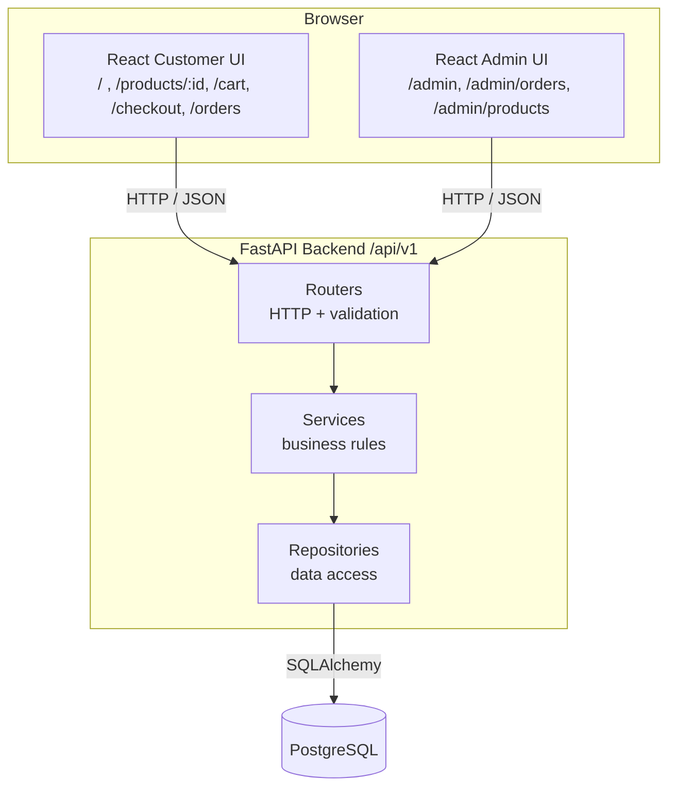
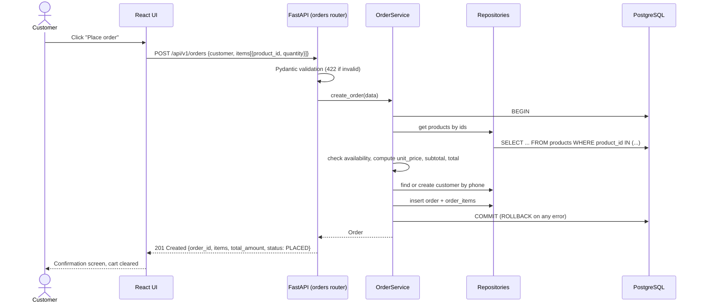
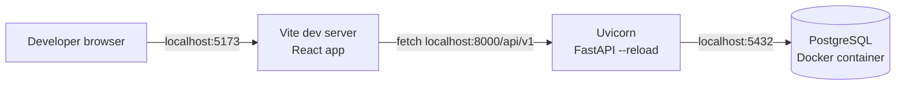
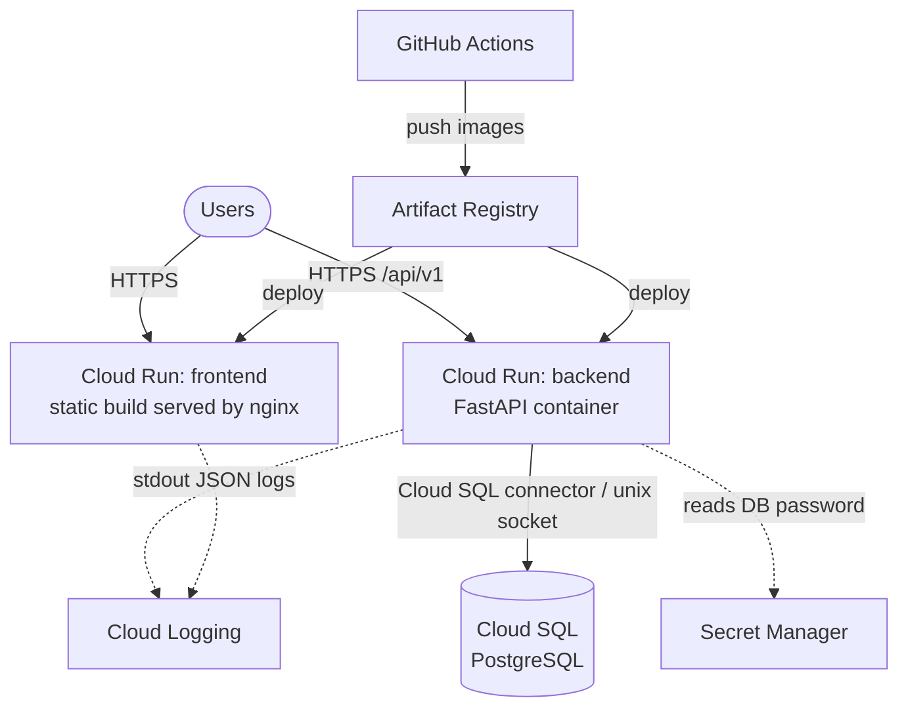

# High-Level Design (HLD)

## 1. Architecture style

**Modular monolith.** One frontend application, one backend service, one database. Inside the backend, code is split into clear modules (products, orders, admin) and layers (routers, services, repositories). This keeps deployment simple while teaching good separation of concerns. **No microservices.**

## 2. Logical architecture

The customer UI and admin UI are **two route trees inside one React app**. They share components, types and the API client. Splitting them into separate apps would add build and deployment work with no learning benefit at POC size.

## 3. Component responsibilities

| Component | Responsibilities | Does NOT do |
|---|---|---|
| React Customer UI | Show products, manage cart (in browser), collect checkout details, show confirmation and history | Calculate authoritative prices or totals |
| React Admin UI | Dashboard counts, order list/details, status changes, product list | Bypass status transition rules |
| FastAPI Routers | Map HTTP to Python, validate input with Pydantic, return JSON and status codes | Business logic or SQL |
| Services | Order total calculation, availability checks, status transitions, transactions | HTTP details |
| Repositories | SQLAlchemy queries for each table | Business decisions |
| PostgreSQL | Durable storage, keys, constraints | – |
| Alembic | Versioned schema migrations | – |

## 4. Communication

| From | To | Protocol | Format |
|---|---|---|---|
| Browser | FastAPI | HTTPS (HTTP locally) REST | JSON |
| FastAPI | PostgreSQL | PostgreSQL wire protocol via SQLAlchemy + psycopg | SQL |
| GitHub Actions | Artifact Registry / Cloud Run | gcloud / Docker | Container images |

All API routes are versioned under `/api/v1`. The frontend reads the API base URL from `VITE_API_BASE_URL`.

## 5. Data flow – placing an order

## 6. External dependencies

| Dependency | Purpose |
|---|---|
| npm registry | Frontend packages |
| PyPI | Backend packages |
| Docker Hub | Base images |
| Google Fonts | Manrope typeface (or self-hosted via `@fontsource/manrope`) |
| GitHub | Code, CI/CD |
| GCP | Hosting (M6) |

## 7. Local development architecture

- M1–M4: PostgreSQL runs in Docker (`docker compose up db`); backend and frontend run on the host for fast reload.
- M5: `docker compose up` runs all three services.
- Config via `.env` files (never committed); `.env.example` documents the variables.

## 8. Future GCP deployment architecture (M6)

| GCP service | Role |
|---|---|
| Cloud Run | Runs frontend and backend containers; scales to zero |
| Cloud SQL (PostgreSQL) | Managed database, smallest tier |
| Artifact Registry | Stores Docker images built by CI |
| Secret Manager | Database password and other secrets |
| Cloud Logging | Collects stdout logs from Cloud Run |

Authentication from GitHub Actions to GCP will use **Workload Identity Federation** (no long-lived JSON keys). Production deploys require manual approval via a GitHub Environment.

**Nothing is deployed to GCP during M0.**

## 9. Extensibility

Future features plug in as new backend modules and frontend route trees without changing the core design: `auth` (OTP), `payments`, `subscriptions`, `deliveries`, `notifications`. Status changes go through one service method, which becomes the hook for notifications.

## Architecture decisions

Any addition to the approved stack needs an entry here (a lightweight Architecture Decision Record).

| ADR | Decision | Status | Reason |
|---|---|---|---|
| ADR-001 | Modular monolith, not microservices | Accepted | POC size; simpler to learn, run and deploy |
| ADR-002 | Customer and admin UIs in one React app | Accepted | Shared components/types; one build |
| ADR-003 | No authentication in POC; customer identified by phone | Accepted (temporary) | Explicitly excluded from scope; documented risk NFR-10 |
| ADR-004 | Cart stored in browser `localStorage`, not the database | Accepted | No extra tables or APIs; cart is not business data until ordered |
| ADR-005 | Add `GET /api/v1/orders?phone=` to the initial endpoint list | Proposed – review in M0 | FR-C7 (order history) cannot be met by the seven listed endpoints |
| ADR-006 | `include_unavailable` query parameter on `GET /api/v1/products` for admin | Proposed – review in M0 | FR-A5 needs unavailable products; avoids a separate admin endpoint |
| ADR-007 | psycopg 3 as the PostgreSQL driver | Accepted | Required by SQLAlchemy to talk to PostgreSQL |
| ADR-008 | nginx to serve the built frontend on Cloud Run | Proposed – confirm in M6 | Cloud Run needs an HTTP server for static files; nginx is the standard minimal choice |
| ADR-009 | Test tooling: pytest + httpx (backend), Vitest + React Testing Library (frontend) | Proposed – confirm in M4 | Standard tools for FastAPI and Vite |
| ADR-010 | Lint/format: Ruff (Python), ESLint + Prettier (TypeScript) | Proposed – confirm in M4 | Fast, widely used, CI-friendly |
