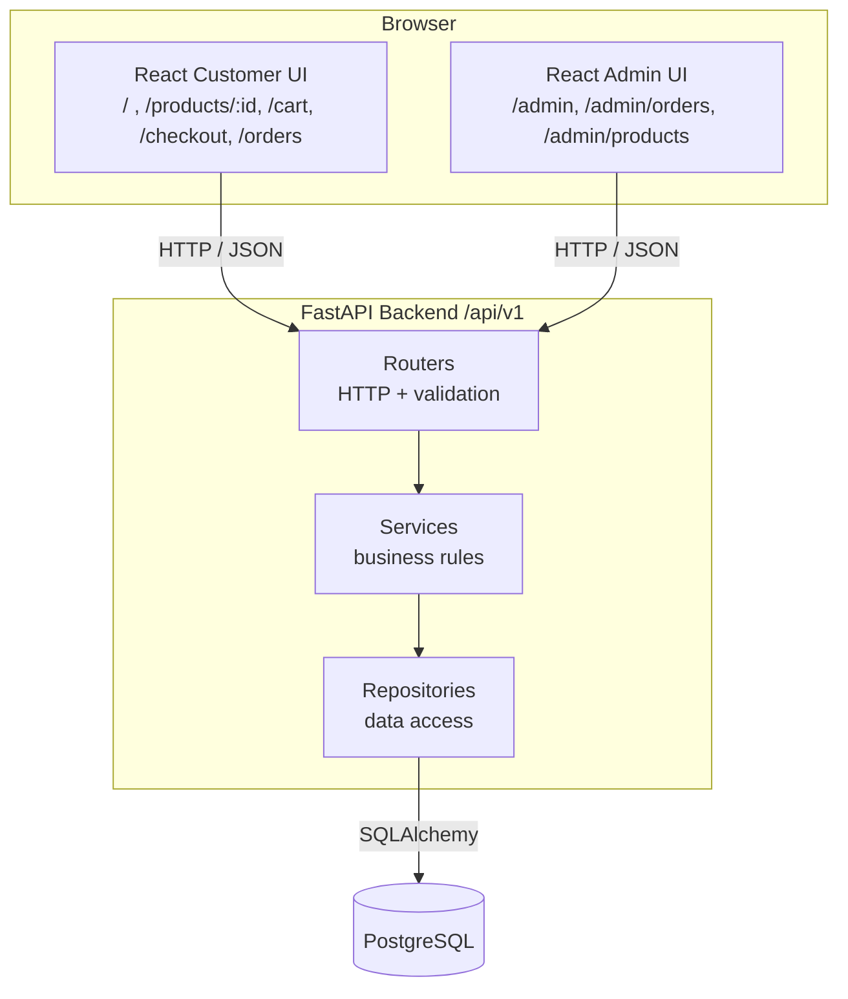
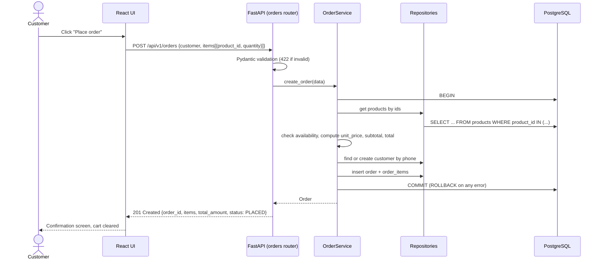
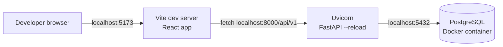
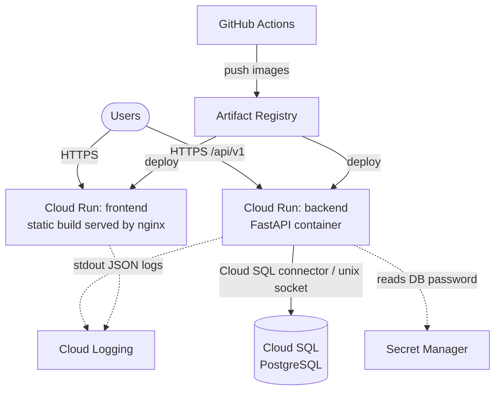
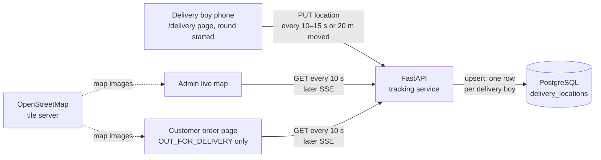

# High-Level Design (HLD)

## 1. Architecture style

**Modular monolith.** One frontend application, one backend service, one database. Inside the backend, code is split into clear modules (products, orders, admin) and layers (routers, services, repositories). This keeps deployment simple while teaching good separation of concerns. **No microservices.**

## 2. Logical architecture

The customer UI and admin UI are **two route trees inside one React app**. They share components, types and the API client. Splitting them into separate apps would add build and deployment work with no learning benefit at POC size.

## 3. Component responsibilities

| Component | Responsibilities | Does NOT do |
|---|---|---|
| React Customer UI | Show products, manage cart (in browser), collect checkout details, show confirmation and history | Calculate authoritative prices or totals |
| React Admin UI | Dashboard counts, order list/details, status changes, product list | Bypass status transition rules |
| FastAPI Routers | Map HTTP to Python, validate input with Pydantic, return JSON and status codes | Business logic or SQL |
| Services | Order total calculation, availability checks, status transitions, transactions | HTTP details |
| Repositories | SQLAlchemy queries for each table | Business decisions |
| PostgreSQL | Durable storage, keys, constraints | – |
| Alembic | Versioned schema migrations | – |

## 4. Communication

| From | To | Protocol | Format |
|---|---|---|---|
| Browser | FastAPI | HTTPS (HTTP locally) REST | JSON |
| FastAPI | PostgreSQL | PostgreSQL wire protocol via SQLAlchemy + psycopg | SQL |
| GitHub Actions | Artifact Registry / Cloud Run | gcloud / Docker | Container images |

All API routes are versioned under `/api/v1`. The frontend reads the API base URL from `VITE_API_BASE_URL`.

## 5. Data flow – placing an order

## 6. External dependencies

| Dependency | Purpose |
|---|---|
| npm registry | Frontend packages |
| PyPI | Backend packages |
| Docker Hub | Base images |
| Google Fonts | Manrope typeface (or self-hosted via `@fontsource/manrope`); Fraunces for customer headings, self-hosted via `@fontsource-variable/fraunces` (ADR-014) |
| GitHub | Code, CI/CD |
| OpenStreetMap tile server | Map images for the Leaflet maps (planned M12, ADR-018). Loaded by the browser, never through our backend; replaceable through `VITE_MAP_TILE_URL` |
| GCP | Hosting (M6) |

## 7. Local development architecture

- M1–M4: PostgreSQL runs in Docker (`docker compose up db`); backend and frontend run on the host for fast reload.
- M5: `docker compose up` runs all three services.
- Config via `.env` files (never committed); `.env.example` documents the variables.

## 8. Future GCP deployment architecture (M6)

| GCP service | Role |
|---|---|
| Cloud Run | Runs frontend and backend containers; scales to zero |
| Cloud SQL (PostgreSQL) | Managed database, smallest tier |
| Artifact Registry | Stores Docker images built by CI |
| Secret Manager | Database password and other secrets |
| Cloud Logging | Collects stdout logs from Cloud Run |

Authentication from GitHub Actions to GCP will use **Workload Identity Federation** (no long-lived JSON keys). Production deploys require manual approval via a GitHub Environment.

**Nothing is deployed to GCP during M0.**

## 9. Extensibility

Future features plug in as new backend modules and frontend route trees without changing the core design: `auth` (OTP), `payments`, `deliveries`, `notifications`. (`subscriptions` was added this way in #97, ADR-015.) Status changes go through one service method, which becomes the hook for notifications. Maps and live delivery tracking (M12, ADR-018) are planned the same way: a `tracking` module in the backend and a `/delivery` route tree in the frontend (section 10).

## 10. Planned: maps and live delivery tracking (M12, ADR-018)

**Not built yet.** Approved by #106; built by #107–#113. Live tracking has two separate paths:

- **Write path:** the phone reads GPS with the browser Geolocation API and sends it; the server keeps only the **latest** position per delivery boy (one row, overwritten).
- **Read path:** the admin and customer maps receive changes as **Server-Sent Events** (#113): saving a position (or a round or order status change) runs `NOTIFY live_updates`; one `LISTEN` thread per backend process wakes that process's open streams, which send a fresh snapshot. Polling every 10 s (#111, #112) stays as the automatic fallback (ADR-020).
- **Map images** come straight from the tile server to the browser; they never touch our backend.
- **Customers are never tracked.** Their location is a pin saved once with an address (#108).
- **Navigate (#134, ADR-021):** each order on the delivery boy's page has a link that opens Google Maps directions to the customer's pin, or to the address text when there is no pin. It is only a link, so Google gets nothing until he taps it.
- **Load:** 20 delivery boys × 1 update per 10 s = 2 writes per second, which PostgreSQL handles easily. Large apps (Uber, Blinkit) handle around 100,000 writes per second, which is why they add Kafka and Redis; we do not need them.
- **Privacy rules:** NFR-17 in `docs/03-requirements/non-functional-requirements.md`.

## Architecture decisions

Any addition to the approved stack needs an entry here (a lightweight Architecture Decision Record).

| ADR | Decision | Status | Reason |
|---|---|---|---|
| ADR-001 | Modular monolith, not microservices | Accepted | POC size; simpler to learn, run and deploy |
| ADR-002 | Customer and admin UIs in one React app | Accepted | Shared components/types; one build |
| ADR-003 | No authentication in POC; customer identified by phone | **Superseded by ADR-013 (#89) and #90** | Ordering and the admin area now need a login; the phone at checkout is only the delivery contact |
| ADR-004 | Cart stored in browser `localStorage`, not the database | Accepted | No extra tables or APIs; cart is not business data until ordered |
| ADR-005 | Add `GET /api/v1/orders?phone=` to the initial endpoint list | **Replaced by `GET /orders/mine` (#90)** | FR-C7 (order history) cannot be met by the seven listed endpoints |
| ADR-006 | `include_unavailable` query parameter on `GET /api/v1/products` for admin | Proposed – review in M0 | FR-A5 needs unavailable products; avoids a separate admin endpoint |
| ADR-007 | psycopg 3 as the PostgreSQL driver | Accepted | Required by SQLAlchemy to talk to PostgreSQL |
| ADR-008 | nginx to serve the built frontend on Cloud Run | Accepted (M5, #57) | Cloud Run needs an HTTP server for static files; nginx is the standard minimal choice. Image: `infrastructure/docker/frontend.Dockerfile` (`nginx:1.29-alpine`) |
| ADR-009 | Test tooling: pytest + httpx (backend), Vitest + React Testing Library (frontend) | Accepted – #49 (frontend: vitest 5.1.0, @testing-library/react 16.3.3, jsdom 31.0.1, all dev only, pinned) | Standard tools for FastAPI and Vite. Vitest reuses `vite.config.ts` (aliases, plugins); jsdom lets components render in Node. Replaced the stop-gap Node built-in test runner (`node:test`) used before M4 |
| ADR-010 | Lint/format: Ruff (Python); **Oxlint 1.93.0 + Prettier 3.10.1** (TypeScript, dev only, pinned) | Accepted – #51 (Ruff), #52 (frontend; changed from ESLint) | Fast, widely used, CI-friendly. **#52: ESLint was replaced by Oxlint** because the frontend uses TypeScript 7, which no longer has the JavaScript API that `typescript-eslint` needs (it supports TypeScript < 6.1). Oxlint (MIT, Rust) parses TypeScript itself, needs no TypeScript package, and has the rules we need: TypeScript, React, React Hooks (`rules-of-hooks`, `exhaustive-deps`), jsx-a11y and Vitest. Config `frontend/.oxlintrc.json` (correctness = error, suspicious = warn, CI fails on warnings too). Turned off on purpose: `react-in-jsx-scope` (React 19's automatic JSX) and `jsx-a11y/prefer-tag-over-role` (our ARIA roles are valid; the rule only prefers other tags). `aria-role` checks HTML elements only (our `<RequireAuth role=…>` is a component prop); fast-refresh export warnings are off in the generated shadcn files. Prettier: no semicolons, double quotes, 120 columns. Rejected: ESLint with a second, older TypeScript just for linting (two TypeScript versions, fragile upgrades) |
| ADR-011 | React Router (`react-router`, data router) for client-side routing | Proposed – M2-04 (#23) | The one React app needs separate customer and admin route trees with shared layouts (ADR-002); React Router is the standard, well-documented choice with nested routes and `<Outlet />` |
| ADR-012 | Admin product management under `/api/v1/admin/products` (POST, PATCH, DELETE); delete only never-ordered products | Accepted – #86 | Scope change requested in #86 (FR-A6). Separate admin paths keep writes where auth can be added later (ADR-003); refusing to delete ordered products protects order history (BR-7). No new libraries. |
| ADR-013 | Username/email + password login with JWT (login changed to mobile number by ADR-019, #121); roles `USER`/`ADMIN`; new libraries **bcrypt 5.0.0** (password hashing) and **PyJWT 2.15.1** (HS256 tokens) | Accepted – #89 | #89 asks for sign-up, login and an admin users page. bcrypt is slow and salted, the standard for password storage; PyJWT is the standard Python JWT library. Tokens are stateless (no server sessions), kept per browser tab in `sessionStorage` (#91, so a user and an admin can be logged in in two tabs): logout deletes the token in that tab, so a copied token stays valid until it expires (60 min). Every `/api/v1/admin/*` route needs an ADMIN token; admins are created only by `app/scripts/create_admin.py`. Since #90 placing and viewing orders also needs a login (`orders.user_id`; an order is visible to its owner and admins only). OTP login stays out of scope. |
| ADR-014 | Second typeface **Fraunces** for customer headings, prices and logo, self-hosted via **@fontsource-variable/fraunces 5.3.0** (SIL Open Font License) | Accepted – #95 | #95 asks for a warmer type design. Fraunces' soft serif matches the product pictures (#94). It is a font-files package of the same kind as the Manrope one (no runtime code, no external request), scoped to `CustomerLayout`, with about 60 KB of font per page for Latin text. Admin keeps Manrope only. |
| ADR-016 | **Recharts 3.10.1** (MIT, pinned exactly) for the admin Income charts | Accepted – #105 | The Income tab (#105) needs line/area, bar and donut charts with tooltips. Recharts is React-first (components, no imperative canvas code), SVG so it stays sharp and themable with our CSS variables, widely used, and supports React 19. Hand-written SVG was the alternative; the participant chose a library for tooltips and animations. Only the admin Income page imports it, and that route is lazy-loaded, so Recharts (~120 kB gzip) is downloaded only when an admin opens Income; customers never load it. |
| ADR-015 | Subscriptions (1 week / 15 days / 1 month) as a `subscriptions` module that creates normal orders; delivery orders made by an **in-process background task** (#99; was an admin button in #97) | Accepted – #97, amended #99 | Approved scope change (#97). Reusing orders keeps one order flow (stock, status, My orders, admin list). #99: an admin button was easy to forget, so the backend runs `generate_orders_for(today)` itself, at startup and every 15 minutes (`app/core/background.py`, standard-library `asyncio`, no scheduler package). It is safe in several workers and when repeated, because of the row locks and `uq_orders_subscription_day`. It only runs while the server runs; `app.scripts.generate_subscription_orders --date` catches up a missed day. Frequency: `every_n_days` 1/2/3. Prices are locked at subscription time; one active subscription per user is a partial unique index. A managed scheduler (e.g. Cloud Scheduler calling the script) can replace the task later. #100: delivery time slots (`delivery_slots` table, admin-managed, capacity = ACTIVE subscriptions) live in the same module; no new library. |
| ADR-017 | pgAdmin (`dpage/pgadmin4:9.19`) as a local-only database viewer in Docker Compose | Accepted (M5) | Lets participants see how data is stored, in the browser (http://localhost:5050), with the database pre-connected. Development tool only: never deployed, not used by the app |
| ADR-019 | **Mobile number + password** login; email and username removed; name mandatory. No new library | Accepted – #121 (amends ADR-013) | Our customers are local households who already give their mobile number at checkout; email and username were extra things to remember that the app never used. For the POC the password stays (bcrypt, JWT unchanged: the token's `sub` is still `user_id`). `users.phone` is unique and normalised to 10 digits (`+91`, a leading `0`, spaces and dashes removed) in the API schema, with a CHECK in the database. It stays separate from `customers.phone` (the delivery contact). The number is **not verified**; for a real launch the plan is **mobile number + OTP** (SMS), which needs an SMS provider and is out of scope (AGENTS.md) until a scope change. The migration refuses to run while old accounts without a number exist (local data only, nothing was deployed) instead of inventing numbers. |
| ADR-018 | Maps and live delivery tracking with **Leaflet 1.9.4** (BSD-2-Clause, pinned exactly, wrapped in our own React hook) plus **@types/leaflet** (MIT, dev only), **OpenStreetMap** map tiles and the browser **Geolocation API**; live updates by **polling** first, then SSE with PostgreSQL `LISTEN/NOTIFY` | Accepted – #106 (built in M12, #107–#113) | Approved scope change (#106): customers drop a pin on an address; delivery boys log in on a phone web page and share their position only during a round; the admin and the customer see it on a map (section 10). Everything is free and open source; Google Maps and Mapbox stay out (cost, API keys, billing account). Leaflet is small, mature and beginner-friendly. **react-leaflet was rejected:** it uses the Hippocratic License 2.1, which is not an OSI-approved open-source licence, and it would add a second runtime dependency; a small hook of our own also teaches how a non-React library lives inside React. OpenStreetMap's standard tile server is free but meant for light use and requires the "© OpenStreetMap contributors" attribution; the tile URL is configuration (`VITE_MAP_TILE_URL`), so production can switch to OpenFreeMap (with MapLibre), MapTiler's free tier or self-hosted tiles without code changes. GPS comes from `navigator.geolocation.watchPosition`, so no native app is needed; the accepted limitation is that tracking pauses when the screen locks (the Screen Wake Lock API keeps it on during a round). Only the latest position per delivery boy is stored, and our load (about 2 writes/s) fits PostgreSQL, so no Redis or Kafka. Polling (TanStack Query `refetchInterval`) works with several Cloud Run instances; SSE (#113) needs `LISTEN/NOTIFY` so every instance hears an update, and `fetch` streaming because `EventSource` cannot send our Bearer token. Distance and ETA are calculated in a service with the Haversine formula (straight line, average speed); road routing (OpenRouteService, GraphHopper, OSRM) is a later option. Privacy rules: NFR-17. |
| ADR-020 | **Server-Sent Events + PostgreSQL `LISTEN/NOTIFY`** for the live maps; polling kept as the fallback. No new library or service | Accepted – #113 | Polling (#111, #112) shows a move after 5 s on average (10 s at worst). With several Cloud Run instances, a position saved by instance A must reach a stream open on instance B: services commit `pg_notify('live_updates', '')` (delivered only on commit), and one `LISTEN` connection per process (`app/core/live_updates.py`, a thread with its own psycopg connection) wakes that process's streams, which re-read the data and send it only if it changed. `StreamingResponse` with `text/event-stream`, a `: ping` every 15 s, and streams end after 25 min (Cloud Run's request limit is 60 min) with `retry: 3000`. The browser reads the stream with `fetch` because `EventSource` cannot send our Bearer token, and falls back to polling whenever the stream is down. **Measured locally** (two uvicorn processes on one PostgreSQL, location sent to one, stream open on the other, 10 updates): **median 34 ms, max 39 ms** with LISTEN/NOTIFY; **≈ 14.7 s** with `LIVE_UPDATES=false` (only the 15 s re-check), which is why the cross-instance signal is needed. Each open stream keeps one request (not a DB connection) busy on its instance: check Cloud Run *concurrency* (default 80) when many customers track at once. Rejected: WebSockets (two-way not needed), Redis pub/sub (a new service for what PostgreSQL already does). |
| ADR-021 | **Google Maps directions links** for the delivery boy's "Navigate" button: a plain `https://www.google.com/maps/dir/?api=1&destination=…` URL, opened only when he taps it. No Google script, API, key or billing account | Accepted – #134 (amends ADR-018) | ADR-018 kept Google Maps out for its cost, API keys and billing account; a directions **link** has none of them. On a phone it opens the Google Maps app with turn-by-turn directions, which OpenStreetMap's website cannot do. Our own maps (address pin, live map, order tracking) stay on Leaflet + OpenStreetMap, and embedding Google Maps (its JavaScript API, tiles or geocoding) is still out. Privacy: the pin or address goes to Google only when the delivery boy taps the button, as if he typed it into a maps app himself; nothing is sent while the page loads. |
