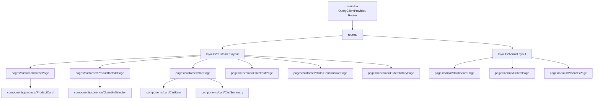
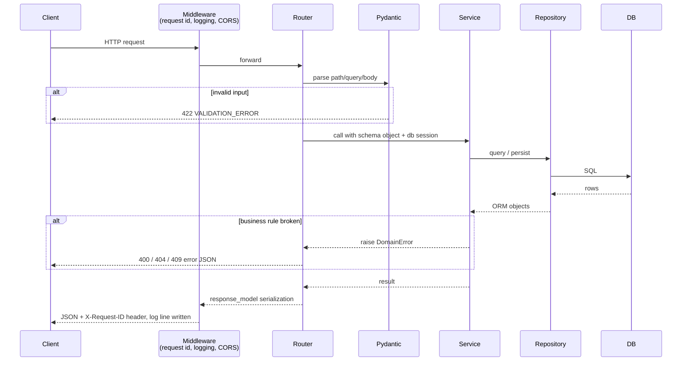

# Low-Level Design (LLD)

## 1. Frontend component structure



| Folder | Contents | Rule |
|---|---|---|
| `pages/` | One component per route | Fetch data with hooks; compose components |
| `components/` | Reusable presentational components | Receive data via props; no direct API calls |
| `hooks/` | `useProducts`, `useProduct(id)`, `useCreateOrder`, `useCart`, `useAdminOrders` … | Wrap TanStack Query / cart state |
| `services/` | `apiClient.ts` (fetch wrapper), `productService.ts`, `orderService.ts` | Only place that knows URLs |
| `types/` | `Product`, `Order`, `OrderItem`, `OrderStatus`, `ApiError` | Mirror the API contract |
| `lib/` | `formatCurrency`, `cn()`, money (paise) maths, `ALLOWED_TRANSITIONS`, validation | Pure functions |
| `components/ui/` | shadcn/ui components (Button, Card, Sheet…) adjusted to the design tokens | Generated by the shadcn CLI, then owned by us |
| `components/orders/`, `components/admin/` | Order timeline/items list; admin details sheet and status control | Same rule as `components/` |

**State:**
- Server state (products, orders) → TanStack Query (caching, loading/error states).
- Cart → React context + `localStorage` (ADR-004).
- In M2, services return mock JSON from `src/services/mock/`; in M3 they switch to HTTP **without changing pages or hooks**.

## 2. Backend module responsibilities

```
backend/app/
├── main.py              # create FastAPI app, include routers, CORS, exception handlers
├── core/
│   ├── config.py        # Settings (pydantic-settings): DATABASE_URL, CORS_ORIGINS, LOG_LEVEL
│   ├── logging.py       # JSON log setup, request-id middleware
│   └── errors.py        # Domain exceptions + handlers → standard error JSON
├── database/
│   ├── base.py          # DeclarativeBase
│   └── session.py       # engine, SessionLocal, get_db() dependency
├── models/              # customer.py, product.py, order.py, order_item.py
├── schemas/             # product.py, order.py, common.py (ErrorResponse, Page)
├── repositories/        # product_repository.py, customer_repository.py, order_repository.py
├── services/            # product_service.py, order_service.py
└── routers/             # health.py, products.py, orders.py, admin_orders.py
```

> `pydantic-settings` is the Pydantic package for environment-based config; it is part of the approved Pydantic stack.

## 3. API request lifecycle



## 4. Business logic separation

| Layer | Example for "update order status" |
|---|---|
| Router | `PATCH /admin/orders/{id}/status`, validates body `{status}` is a known enum |
| Service | Loads order, checks `ALLOWED_TRANSITIONS[current]` contains new status, raises `InvalidStatusTransition` otherwise, saves |
| Repository | `get_by_id(order_id)`, `save(order)` |
| Model | `Order` with `status` column |

Rule of thumb: if a rule would still apply when called from a CLI script instead of HTTP, it belongs in the service.

## 5. Database access patterns

- **One session per request** via the `get_db()` dependency (`yield` session, close in `finally`).
- Repositories receive the session; they never create their own.
- Avoid N+1 queries: load order items with `selectinload(Order.items)` and products in one `IN (...)` query.
- Pagination: `LIMIT/OFFSET` with `page` and `page_size` (max 100).
- Read-only queries do not open explicit transactions.

## 6. Transaction handling

Order creation must be atomic (NFR-5, BR-6):

```python
# order_service.py (illustrative pseudocode – not implemented in M0)
def create_order(db: Session, data: OrderCreate) -> Order:
    with db.begin():                      # commits on success, rolls back on exception
        products = product_repo.get_many(db, ids)
        validate_all_exist_and_available(products, ids)
        customer = customer_repo.get_or_create(db, data.customer)
        order = Order(customer=customer, status=OrderStatus.PLACED)
        for item in data.items:
            price = products[item.product_id].price          # DB price, never client price
            order.items.append(OrderItem(product_id=item.product_id,
                                         quantity=item.quantity,
                                         unit_price=price,
                                         subtotal=price * item.quantity))
        order.total_amount = sum(i.subtotal for i in order.items)
        order_repo.add(db, order)
    return order
```

Status updates use a short transaction and `SELECT ... FOR UPDATE` on the order row to avoid two admins applying conflicting changes.

## 7. Validation

| Where | What |
|---|---|
| Frontend | UX validation (required fields, quantity 1–20, phone format). Helpful, **not trusted**. |
| Pydantic schemas | Types, lengths, ranges, regex for phone `^[6-9]\d{9}$`, `items` 1–10 entries, `quantity` 1–20, no unknown fields |
| Services | Business rules: products exist and are available, no duplicate product ids, legal status transitions |
| Database | NOT NULL, FK, CHECK, UNIQUE constraints as the last line of defence |

## 8. Error handling

Domain exceptions defined in `core/errors.py` map to HTTP responses in one place:

| Exception | HTTP | `error.code` |
|---|---|---|
| `RequestValidationError` (FastAPI) | 422 | `VALIDATION_ERROR` |
| `NotFoundError` | 404 | `NOT_FOUND` |
| `ProductUnavailableError` | 409 | `PRODUCT_UNAVAILABLE` |
| `InvalidStatusTransitionError` | 409 | `INVALID_STATUS_TRANSITION` |
| `DuplicateProductError` | 400 | `DUPLICATE_PRODUCT` |
| Unhandled `Exception` | 500 | `INTERNAL_ERROR` (no stack trace returned; logged with request id) |

Response shape is defined in [`../05-api/api-contracts.md`](../05-api/api-contracts.md#error-format). The frontend `apiClient` converts error responses into a typed `ApiError` so pages can show `error.message`.
