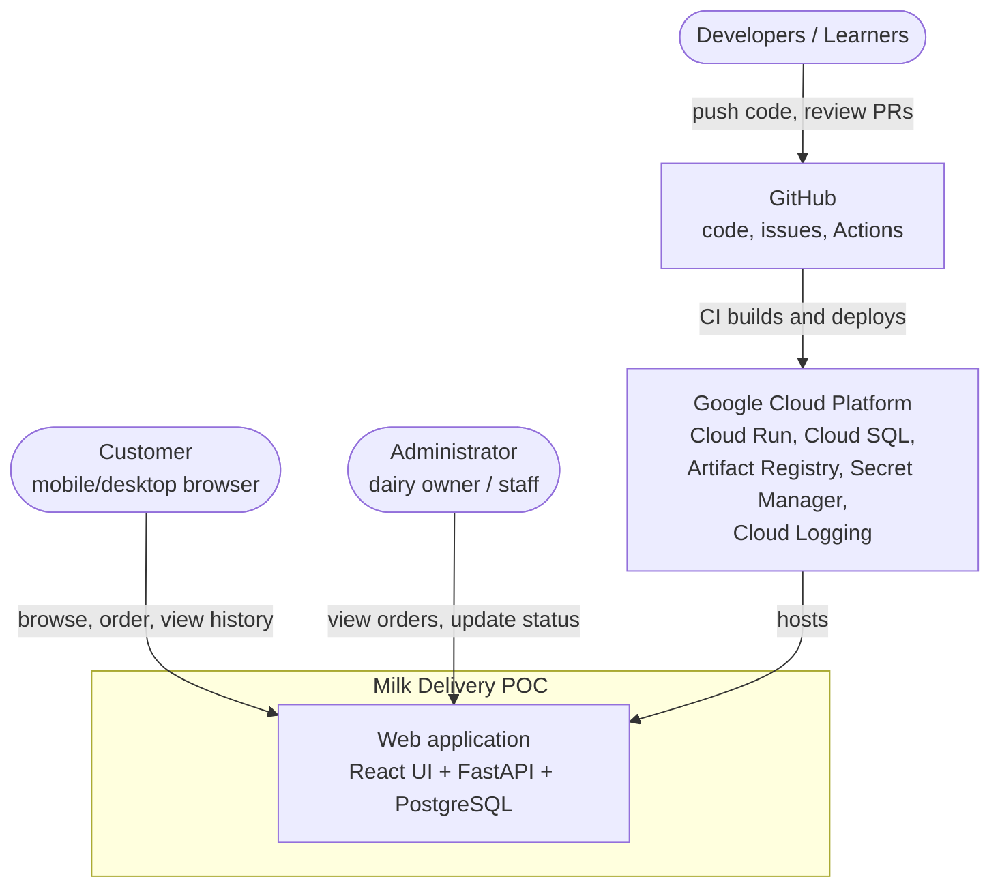

# System Context

The system context shows the Milk Delivery POC as one box and everything it interacts with. It answers: *who uses the system, and what does it depend on?*

## Actors

| Actor | Interaction |
|---|---|
| Customer | Uses the customer UI in a browser |
| Administrator | Uses the admin UI in a browser |
| Developers / learners | Work through GitHub; never change production directly |

## External systems

| System | Used for | From milestone |
|---|---|---|
| GitHub | Source control, issues, project board, Actions CI/CD | M0 |
| Docker Hub | Base images (`python`, `node`, `postgres`) | M5 |
| Google Cloud Platform | Hosting, database, secrets, logs | M6 |

No other external systems (SMS, payments, maps, messaging) are used in the POC.
