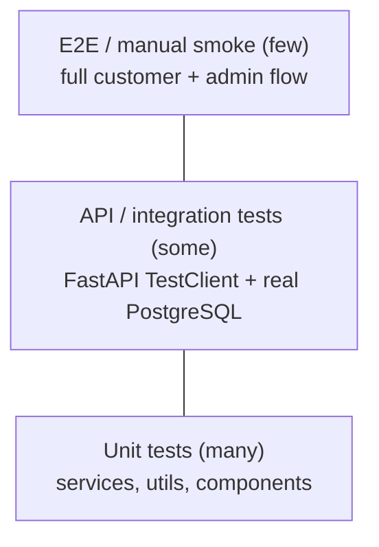

# Test Strategy

## Goals

- Catch bugs before merge, not in production.
- Prove the business rules (especially **backend-calculated totals** and **status transitions**).
- Teach participants to write tests as part of every feature.

## Test pyramid

## Levels

| Level | Tools (ADR-009) | What | Where |
|---|---|---|---|
| Backend unit | pytest | Services: total calculation, transitions, validation | `backend/tests/unit/` |
| Backend API | pytest + FastAPI `TestClient` (httpx) | Each endpoint: success + every documented error | `backend/tests/api/` |
| Database | pytest against PostgreSQL (Docker locally, service container in CI) | Migrations apply cleanly; constraints enforced | `backend/tests/db/` |
| Frontend unit | Vitest + React Testing Library | Hooks, utils (`formatCurrency`), cart logic, components | `frontend/src/**/*.test.tsx` |
| Manual smoke | Checklist | Full flow on local Compose and on Cloud Run | `docs/07-testing/` (checklist added in M4) |

## Must-have test cases

| Area | Case |
|---|---|
| Orders | Total = Σ(DB price × qty) even if client tries to send a price (rejected) |
| Orders | Unavailable product → 409, nothing saved |
| Orders | Unknown product → 404, nothing saved |
| Orders | Duplicate product id → 400 |
| Orders | Quantity 0 and 21 → 422 |
| Orders | Invalid phone → 422 |
| Orders | Existing phone reuses the customer; new phone creates one |
| Orders | Price changed after order → old order keeps old `unit_price` |
| Status | Every allowed transition succeeds; each illegal one → 409 |
| Products | Customer list hides unavailable; `include_unavailable=true` shows all |
| Health | 200 with DB up |
| Frontend | Cart add/merge/remove/persist; quantity bounds; currency formatting |

## Test data

- Seed data from `database/seed.sql` (4 products, 1 demo customer).
- Tests create their own data with small factory helpers and run each test in a transaction that is rolled back.
- Never use real customer data.

## Quality gates (from M4/M5)

| Gate | Threshold |
|---|---|
| All tests pass | required |
| Backend service-layer coverage | ≥ 70 % |
| Lint (Ruff, ESLint) and type check (`tsc --noEmit`) | zero errors |
| Build succeeds (frontend `vite build`, backend Docker image) | required |

## Rules

- Every bug fix includes a test that fails before the fix.
- Do not delete or skip tests to make CI pass. If a test is wrong, explain why in the PR.
- AI assistants must report actual test commands and results (see `AGENTS.md`).
