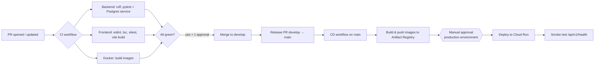

# CI/CD Strategy

CI/CD is built **incrementally**. In M0 there is a placeholder workflow only; real pipelines arrive in M5 (CI) and M6 (CD).

## Pipeline overview

## Workflows (planned)

| File | Trigger | Jobs | Milestone |
|---|---|---|---|
| `.github/workflows/ci-placeholder.yml` | PR, push to `develop`/`main` | Checks repo docs exist | M0 |
| `.github/workflows/ci.yml` | PR to `develop`/`main` | `backend`, `frontend`, `docker-build` | M5 |
| `.github/workflows/deploy.yml` | Push to `main`, manual | `build-push`, `deploy` (environment: `production`) | M6 |

## CI details (M5)

| Job | Steps |
|---|---|
| backend | Python 3.12 → install deps → `ruff check` → `alembic upgrade head` on service Postgres → `pytest --cov` |
| frontend | Node 20 LTS → `npm ci` → `npm run lint` → `npm run typecheck` → `npm test -- --run` → `npm run build` |
| docker-build | `docker build` backend and frontend images (no push) |

Caching: pip and npm caches via `actions/setup-python` and `actions/setup-node`.

## CD details (M6)

- Authenticate to GCP with **Workload Identity Federation** (`google-github-actions/auth`), no JSON keys in GitHub.
- Tag images with the Git SHA: `REGION-docker.pkg.dev/PROJECT/milk-delivery/backend:<sha>`.
- `production` GitHub Environment with required reviewers → manual approval before deploy.
- Run Alembic migrations as a Cloud Run Job before switching traffic.
- Rollback: redeploy the previous image tag (`gcloud run services update-traffic`).

## Secrets and variables

| Name | Where | Used by |
|---|---|---|
| `GCP_PROJECT_ID` | Repo variable | CD |
| `GCP_REGION` | Repo variable (e.g. `asia-south1`) | CD |
| `GCP_WORKLOAD_IDENTITY_PROVIDER` | Repo variable | CD |
| `GCP_SERVICE_ACCOUNT` | Repo variable | CD |
| DB password | **GCP Secret Manager** (not GitHub) | Cloud Run backend |

## Principles

- CI must be fast (< 10 min) and reliable. Flaky tests are fixed, not retried forever.
- Required status checks are only enabled once the workflow exists and has passed at least once.
- No deploys from feature branches.
