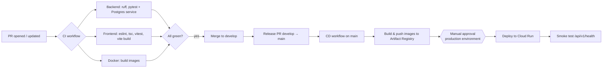

# CI/CD Strategy

CI/CD is built **incrementally**. **CI is live since M5** (`.github/workflows/ci.yml`, #60 #61); CD (deployment) arrives in M6.

## Pipeline overview

## Workflows

| File | Trigger | Jobs | Milestone |
|---|---|---|---|
| ~~`.github/workflows/ci-placeholder.yml`~~ | – | Removed in M5 (#61), replaced by `ci.yml` | M0 |
| `.github/workflows/ci.yml` | PR to and push on `develop`/`main` | `backend`, `frontend`, `docker-build` (in parallel) | M5 ✅ |
| `.github/workflows/deploy.yml` | Push to `main`, manual | `build-push`, `deploy` (environment: `production`) | M6 |

## CI details (M5)

| Job | Steps |
|---|---|
| backend | Python 3.12 (pip cache) → install deps → `ruff check` → `ruff format --check` → `alembic upgrade head` on a PostgreSQL 16 service container → `pytest --cov` (test database `milk_delivery_test`) |
| frontend | Node 24 (npm cache) → `npm ci` → `npm run typecheck` → `npm test` → `npm run build` |
| docker-build | `docker compose build backend frontend` (builds both images, nothing is pushed) |

- Node 24, not 20: Vite 8 needs Node 20.19+/22.12+ and Node 20 is end-of-life; same version as the frontend Docker image.
- **Not yet in CI:** frontend lint (ESLint arrives with M4 #52) and a coverage minimum (M4 #53). Add them to `ci.yml` when those issues are done.
- A newer push to the same branch cancels the older run (`concurrency`).
- Where to see results: the **Checks** section at the bottom of every PR, or the **Actions** tab.

## CD details (M6)

- Authenticate to GCP with **Workload Identity Federation** (`google-github-actions/auth`), no JSON keys in GitHub.
- Tag images with the Git SHA: `REGION-docker.pkg.dev/PROJECT/milk-delivery/backend:<sha>`.
- `production` GitHub Environment with required reviewers → manual approval before deploy.
- Run Alembic migrations as a Cloud Run Job before switching traffic.
- Rollback: redeploy the previous image tag (`gcloud run services update-traffic`).

## Secrets and variables

| Name | Where | Used by |
|---|---|---|
| `GCP_PROJECT_ID` | Repo variable | CD |
| `GCP_REGION` | Repo variable (e.g. `asia-south1`) | CD |
| `GCP_WORKLOAD_IDENTITY_PROVIDER` | Repo variable | CD |
| `GCP_SERVICE_ACCOUNT` | Repo variable | CD |
| DB password | **GCP Secret Manager** (not GitHub) | Cloud Run backend |

## Principles

- CI must be fast (< 10 min) and reliable. Flaky tests are fixed, not retried forever.
- Required status checks are only enabled once the workflow exists and has passed at least once.
- No deploys from feature branches.
