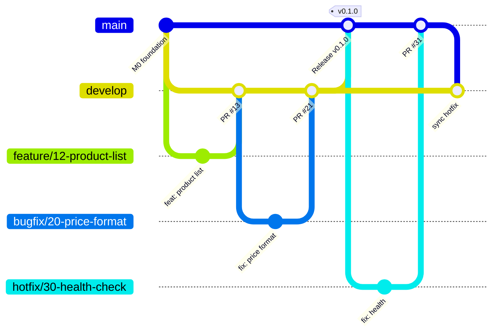

# Git Workflow and Pull Request Standards

## Branch model



| Branch | Purpose | Created from | Merges into | Direct push |
|---|---|---|---|---|
| `main` | Production-ready, deployable | – | – | ❌ |
| `develop` | Integration of finished work | `main` | `main` via release PR | ❌ |
| `feature/<issue>-<slug>` | New work for one issue | `develop` | `develop` | ✅ (author) |
| `bugfix/<issue>-<slug>` | Non-urgent fix | `develop` | `develop` | ✅ (author) |
| `hotfix/<issue>-<slug>` | Urgent production fix | `main` | `main`, then back-merge to `develop` | ✅ (author) |

Naming: lowercase, hyphens, issue number first. Example: `feature/12-product-list-endpoint`.

## Daily workflow

```bash
# 1. Start from an up-to-date develop
git checkout develop
git pull origin develop

# 2. Create your branch
git checkout -b feature/12-product-list-endpoint

# 3. Work in small commits
git add backend/app/routers/products.py
git commit -m "feat(backend): add GET /api/v1/products (#12)"

# 4. Keep up to date with develop (rebase your own branch only)
git fetch origin
git rebase origin/develop

# 5. Push and open a PR into develop
git push -u origin feature/12-product-list-endpoint
```

## Commit messages

`type(scope): summary (#issue)` – imperative mood, ≤ 72 characters.

| Type | Use |
|---|---|
| feat | New behaviour |
| fix | Bug fix |
| docs | Documentation only |
| test | Tests only |
| refactor | Code change without behaviour change |
| chore | Tooling, config |
| ci | GitHub Actions |
| build | Docker, dependencies |

Scopes: `backend`, `frontend`, `db`, `api`, `docs`, `ci`, `infra`.

## Pull request rules

1. Every PR references an issue: `Closes #12` in the description.
2. Use the PR template. Fill every section; write "N/A" with a reason if not applicable.
3. Target `develop`, except release PRs (`develop → main`) and hotfixes (`hotfix/* → main`).
4. Keep PRs small and focused on one issue (aim < 400 changed lines).
5. **At least one approving review from someone other than the author.**
6. All CI checks green (from M5; until then, the author pastes local test output).
7. All review conversations resolved.
8. **Squash and merge** into `develop` (one clean commit per issue). **Merge commit** for `develop → main` releases.
9. Delete the feature branch after merge (GitHub can do this automatically).

## Code review checklist

- [ ] Does the change meet every acceptance criterion?
- [ ] Is it limited to the issue's scope?
- [ ] Are there tests, and do they test behaviour, not implementation?
- [ ] Is the code readable? Are names clear?
- [ ] Does it follow the layering (router → service → repository)?
- [ ] Any secrets, debug prints or commented-out code?
- [ ] Is documentation updated?
- [ ] **Can the author explain the code, including AI-generated parts?**

## Branch protection (target configuration)

| Rule | `main` | `develop` |
|---|---|---|
| Require pull request before merging | ✅ | ✅ |
| Required approvals | 1 | 1 |
| Dismiss stale approvals on new commits | ✅ | ✅ |
| Require conversation resolution | ✅ | ✅ |
| Require status checks (CI) | ✅ (from M5) | ✅ (from M5) |
| Block force pushes | ✅ | ✅ |
| Block deletion | ✅ | ✅ |
| Restrict who can merge | Maintainers | Maintainers + contributors with write |
| Admin bypass | Allowed (emergency only, must be explained in PR) | Allowed |

**Why admin bypass is allowed:** with a small team, a single maintainer must be able to fix a broken setting without locking everyone out. Bypass use must be rare and documented.

**Required status checks are added only after the CI workflow exists (M5).** Requiring a check that never runs would block every PR.

**Note:** GitHub only enforces branch protection / rulesets on **private** repositories with a paid plan (Pro, Team or Enterprise). On a free plan, protection works only on **public** repositories. If protection cannot be enabled, the rules above are enforced by team agreement and review.

## Releases

- When a milestone is complete, open a release PR `develop → main` titled `release: vX.Y.0 – <milestone>`.
- After merge, tag `main`: `git tag -a v0.1.0 -m "M1 – Backend Foundation"`.
- Production deployment (M6+) runs from `main` and requires approval in the `production` GitHub Environment.
